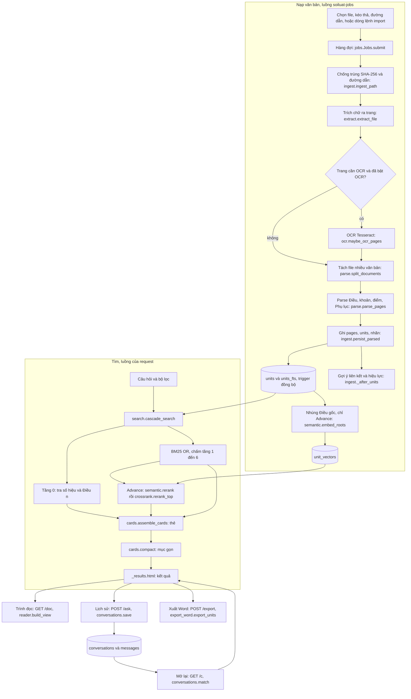
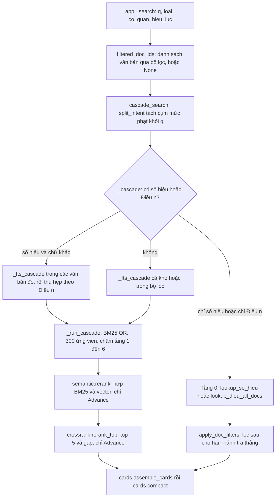

# Soi Luật: kiến trúc và chức năng

Bản app 0.9.0 · cập nhật 31/10/2026 · khớp mã nguồn ở commit `a13af05` (commit cuối cùng đổi `src/`). Người đọc: người bảo trì, người build và đóng gói, người đo chất lượng tìm kiếm, agent làm tiếp lộ trình.

Tài liệu này là nguồn chuẩn cho **kiến trúc và chức năng** của 0.9.0. Cách đọc:

- Mọi tên tệp, hàm, hằng, bảng, route trong tài liệu là tên thật ở mã. Kiểm bằng `grep -rn <tên> src tests pack bench`.
- Số đo không nằm ở đây. Mỗi sự thật có một nơi sở hữu; mục 1.6 chỉ đường. Hằng số trong mã (`CANDIDATES`, `TOP`…) là sự thật của mã, không phải số đo.
- Hướng dẫn cho người dùng cuối: [`HUONG-DAN-DON-GIAN.md`](../HUONG-DAN-DON-GIAN.md) (ngắn) và [`HUONG-DAN.md`](../HUONG-DAN.md) (đầy đủ). Bản đồ toàn bộ tài liệu: [`README.md`](README.md) trong thư mục này.

**Đổi số mục so với bản 0.8** (tài liệu cũ tên `TAI-LIEU-KY-THUAT.md`; các tài liệu khác có thể còn trích số cũ):

| Mục cũ | Nay |
|---|---|
| 2.1 Các module | 3 |
| 2.2 Lược đồ dữ liệu | 4 |
| 3 Luồng nạp, nâng cấp dữ liệu | 2.1 (sơ đồ), 6 (việc nền, nâng cấp dữ liệu) |
| 4, 4.1, 4.2, 4.3 Luồng tìm kiếm | 7 |
| 5.1, 5.2, 5.3 Chất lượng đã đo | không còn ở đây: [`nghien-cuu/so-thu-nghiem.md`](nghien-cuu/so-thu-nghiem.md) (TK-07, TK-08, TK-09) và [`../README.md`](../README.md) |
| 6 Cấu hình, 7 Dòng lệnh | 2.4, 2.5 |
| 8 Đóng gói và phát hành | 9 |
| 9 Bảo mật và riêng tư | 1.5, 5.1 |
| 10 Kiểm thử | 10 |
| 11 Giới hạn đã biết | 11 |

---

## 1. Mục đích và phạm vi

### 1.1 Soi Luật là gì

App tra cứu văn bản pháp luật Việt Nam, chạy hoàn toàn offline trên máy Windows văn phòng. Người dùng nạp thư viện văn bản của chính họ (Word, PDF, ảnh scan, Excel, TXT, Markdown) vào một kho SQLite cục bộ, rồi hỏi bằng từ khoá, câu tự nhiên hoặc số hiệu văn bản. Kết quả là **nguyên văn** Điều, khoản, điểm kèm văn bản nguồn và số trang. Bấm vào một kết quả thì văn bản mở ngay trong app, đúng đoạn.

Công nghệ: Python 3.11, FastAPI và uvicorn trên `127.0.0.1`, Jinja2 trả HTML từng phần, JavaScript thuần (không Node, không SPA), SQLite ở chế độ WAL với FTS5. Bản Windows đóng bằng PyInstaller (onedir) nên máy chạy không cần cài Python.

### 1.2 App làm gì

- Nạp file: chọn nhiều file hoặc cả thư mục, kéo thả, đường dẫn có sẵn, hoặc dòng lệnh `import`. Có OCR tiếng Việt cho trang scan và ảnh.
- Tách văn bản thành Điều, khoản, điểm (và đoạn, Phụ lục, ghi chú) để mỗi đơn vị tìm được và trích được riêng.
- Tìm: tra thẳng số hiệu và "Điều n"; tìm theo chữ (BM25 nhiều tầng, từ điển đồng nghĩa); tuỳ chọn tìm theo nghĩa và xếp lại top-5 (chế độ Advance).
- Hiện kết quả gọn: mỗi mục một (văn bản, Điều), nhóm theo văn bản, gộp Điều trùng nội dung ở văn bản khác.
- Trình đọc: toàn văn tại đúng đoạn, tô chữ khớp, chuỗi trích dẫn sao chép được, tab ảnh trang gốc.
- Lịch sử trò chuyện: lưu câu hỏi, mở lại không tìm lại, tìm, đổi tên, xoá.
- Xuất Word nguyên văn các đơn vị đã chọn; sao lưu SQLite.
- Cho người duyệt: liên kết nghĩa vụ và chế tài, gợi ý hiệu lực, luật chủ thể, từ điển đồng nghĩa, danh sách văn bản (sửa hiệu lực và số hiệu), truy vấn bỏ sót.

### 1.3 App không làm gì

- **Không sinh văn bản.** Lõi trả lời bằng mô hình ngôn ngữ (`answer.py`) có trong mã nhưng chưa gắn vào giao diện; chỉ `bench/llm/run.py` gọi nó. Giai đoạn P3 sẽ gắn ([`ke-hoach/lo-trinh-1.0.md`](ke-hoach/lo-trinh-1.0.md) mục 6).
- Không tự kết luận văn bản còn hay hết hiệu lực. `documents.hieu_luc` mặc định `chua_ro`; chỉ người duyệt đổi.
- Không sửa ranh giới Điều hay chữ OCR trong app (sửa file nguồn rồi nạp lại). Không có nút xoá từng văn bản.
- Không có nhiều người dùng, đăng nhập, đồng bộ giữa các máy, tự cập nhật qua mạng. Danh sách đầy đủ: [lộ trình mục 10](ke-hoach/lo-trinh-1.0.md).

### 1.4 Người dùng

| Vai | Làm gì | Ở đâu trong app |
|---|---|---|
| Nhân viên văn phòng | Nạp văn bản, hỏi, đọc, sao chép trích dẫn, xuất Word | Trang chính `/`, trình đọc `/doc/{id}` |
| Người duyệt (thường là cùng người) | Duyệt liên kết, hiệu lực, luật chủ thể, từ điển; sửa số hiệu | Các trang `/review*`, `/missed` (mở từ Cài đặt, mục Quản lý kho) |
| Người bảo trì, build, đo | Chạy dòng lệnh, đóng gói, chạy bộ đo | Mục 2.5, 9, 10 |

Máy mục tiêu: Windows 10 hoặc 11 x64, một người dùng, Office có thể đang mở. Thông số máy và dung lượng: [`../README.md`](../README.md).

### 1.5 Lời hứa offline và cách mã giữ

- `config.HOST = "127.0.0.1"`; `app.main` gọi `uvicorn.run(..., host=HOST)`. Test: `test_bind_localhost_only` (`test_pack_spec.py`).
- `app.HostGuard` từ chối `Host` lạ và `Origin` lạ (mục 5.1). Mọi POST cần token CSRF.
- Không tải gì lúc chạy: hai mô hình AI nằm trên đĩa (`semantic.model_dir`, `crossrank.model_dir`); phông Be Vietnam Pro nằm ở `static/fonts/` (test `test_phong_nhung_khong_tai_tu_ngoai`, `test_static.py`); không có phân tích sử dụng, không có cập nhật tự động.
- `bench/kiem_anh.js` báo mọi yêu cầu ra ngoài `127.0.0.1` khi chụp giao diện.
- Một ngoại lệ đã biết: trang tài liệu tự sinh của FastAPI (`/docs`, `/redoc`) nạp JS và CSS từ CDN. Giao diện không có liên kết tới chúng. Xem mục 11.
- Dữ liệu văn bản, nhật ký câu hỏi, lịch sử và vector chỉ nằm trong thư mục dữ liệu (mục 2.3). Văn bản kiểm thử có dữ liệu thật không vào gói hay git; câu hỏi gold `vle` giữ ngoài repo.

### 1.6 Con số nằm ở đâu

| Cần biết | Nơi sở hữu |
|---|---|
| Độ chính xác Normal và Advance (Zalo test, gold `vle`, 21 văn bản thật) | [`nghien-cuu/so-thu-nghiem.md`](nghien-cuu/so-thu-nghiem.md) TK-07, TK-09; [`../bench/zalo/KET-QUA.md`](../bench/zalo/KET-QUA.md); [`../bench/van-ban-that/KET-QUA.md`](../bench/van-ban-that/KET-QUA.md); tóm tắt cho người dùng ở [`../README.md`](../README.md) |
| Phương án tìm đã thử và loại | [`nghien-cuu/so-thu-nghiem.md`](nghien-cuu/so-thu-nghiem.md) TK-08 và nhóm CN |
| Độ trễ, RAM đỉnh, dung lượng bộ cài, thời gian nạp và nhúng | [`../README.md`](../README.md) (mục tìm theo nghĩa, mục Đóng gói), [`../HUONG-DAN.md`](../HUONG-DAN.md) |
| Số đo từng việc của P1 (trình đọc, kết quả gọn, lịch sử) | `so-thu-nghiem.md` nhóm HT; [`ke-hoach/ke-hoach-p1.md`](ke-hoach/ke-hoach-p1.md) |
| Cổng đo và lệnh chạy | [`quy-trinh.md`](quy-trinh.md) mục 4 |
| Trạng thái bàn giao, bước đầu tiên, bẫy | [`nghien-cuu/ghi-nho.md`](nghien-cuu/ghi-nho.md) |
| Lộ trình, quyết định còn mở | [`ke-hoach/lo-trinh-1.0.md`](ke-hoach/lo-trinh-1.0.md) mục 6, 9 |
| Ghi chú phát hành | [`../CHANGELOG.md`](../CHANGELOG.md) |

---

## 2. Kiến trúc tổng quan

### 2.1 Luồng dữ liệu



Hai nửa chạy ở hai chỗ khác nhau. Nửa **nạp** chạy trong một luồng nền (hoặc trong dòng lệnh `import`, cùng mã). Nửa **tìm** chạy trong luồng của từng request. Chúng gặp nhau ở kho SQLite, ở hai bộ nhớ đệm dùng chung (ma trận vector `semantic._ALL`, chỉ mục tên Điều `search._TITLE_CACHE`) và ở trạng thái `JOBS.migrate`, mà tìm kiếm đọc khi kho đang được nâng cấp (mục 6.5).

### 2.2 Tiến trình và luồng

Một tiến trình (`SoiLuat.exe` hoặc `python -m soiluat`), ba loại luồng.

| Luồng | Tạo ở | Việc |
|---|---|---|
| Luồng của uvicorn | `uvicorn.run` trong `app.main` | Mọi route khai báo bằng `def` chạy trong threadpool; tìm kiếm Advance chặn một luồng trong lúc tìm |
| `soiluat-jobs` | `jobs.Jobs._ensure_thread` | **Một** luồng: lần lượt nạp từng file, nâng cấp dữ liệu, nhúng vector (mục 6) |
| `soiluat-warm` | `app.main` (`app._warm_models`) | Nạp trước encoder, reranker và ma trận vector để câu hỏi đầu không gánh thời gian nạp mô hình; lỗi thì để lần tìm đầu tự nạp |

Mỗi request mở một kết nối SQLite riêng (`app.get_conn`: `db.connect` rồi `db.init_schema`). Luồng `soiluat-jobs` có kết nối riêng. Quy tắc khoá: mục 6.7.

### 2.3 Thư mục dữ liệu

`config.data_dir()`: biến `SOILUAT_DATA`, mặc định `.\data` tính từ thư mục làm việc. Lối tắt của bộ cài đặt thư mục làm việc là `%LOCALAPPDATA%\SoiLuat`, nên kho nằm ở `%LOCALAPPDATA%\SoiLuat\data`.

| Đường dẫn | Nội dung | Ghi bởi |
|---|---|---|
| `data\soiluat.db` (và `-wal`, `-shm`) | Kho SQLite duy nhất | mọi nơi |
| `data\files\` | Bản sao file tải lên từ trình duyệt (giữ để xem ảnh trang gốc) | `app._store_upload` |
| `data\backup\soiluat.db` | Bản sao lưu do người dùng bấm | `POST /backup`, `db.backup_db` |
| `data\backup\soiluat-truoc-parse<PARSE_REV>.db` | Bản sao lưu tự động trước nâng cấp dữ liệu | `jobs._migrate_step` |
| `data\export.docx` | Tệp Word vừa xuất (ghi đè mỗi lần) | `POST /export` |
| `data\models\aiteamvn-embedding`, `data\models\aiteamvn-reranker` | Hai mô hình Advance (bản đóng gói: `models\` cạnh `SoiLuat.exe`) | `pack\export_models.py`, `pack\build.ps1` |
| `tesseract\` cạnh `SoiLuat.exe` | Tesseract đi kèm (bản đóng gói) | `pack\build.ps1` |

File nạp bằng đường dẫn có sẵn (`POST /import/path`, `import <đường dẫn>`) giữ nguyên chỗ cũ, không sao chép. `documents.file_path` là đường dẫn tương đối so với `data\` nếu nằm trong đó, ngược lại là đường dẫn tuyệt đối (`ingest.relative_path`).

### 2.4 Biến môi trường

Tất cả tuỳ chọn.

| Biến | Tác dụng | Đọc ở |
|---|---|---|
| `SOILUAT_DATA` | Thư mục dữ liệu | `config.data_dir` |
| `SOILUAT_PORT` | Cổng mong muốn (mặc định 8000; bận thì thử 20 cổng kế tiếp) | `app.main`, `app.pick_port` |
| `SOILUAT_NO_BROWSER=1` | Không tự mở trình duyệt | `app.main` |
| `SOILUAT_MODEL_DIR`, `SOILUAT_RERANK_DIR` | Thư mục mô hình embedding và reranker | `semantic.model_dir`, `crossrank.model_dir` |
| `SOILUAT_SEMANTIC=0` | Tắt hẳn vector và reranker (Advance chạy như Normal) | `semantic.encoder`, `crossrank.ranker` |
| `SOILUAT_TESSERACT` | Đường dẫn `tesseract.exe` | `ocr.find_tesseract` |
| `SOILUAT_TESSDATA`, `TESSDATA_PREFIX` | Thư mục có `vie.traineddata` | `ocr.find_tessdata` |
| `SOILUAT_ALLOW_TEST_HOST=1` | **Chỉ cho test**: thêm `Host` `testserver`, bỏ kiểm CSRF và không đặt cookie. Không đặt ở máy dùng thật | `app._test_bypass`; `tests/conftest.py` bật cho mọi test |

### 2.5 Dòng lệnh

```text
SoiLuat.exe                                  mở app (python -m soiluat)
SoiLuat.exe import <file hoặc thư mục> [--ocr] [--doan] [--nhung [--nen]]
SoiLuat.exe import --nhung [--nen]           chỉ nhúng vector còn thiếu; --nen: 1 luồng, ưu tiên CPU thấp
SoiLuat.exe import --check-ocr               in một dòng JSON về trạng thái OCR
python -m soiluat.health <thư mục> -o health.csv   khám sức khoẻ một thư mục file (CSV)
```

`app.main` nhận `--port`. `import` do `importer.main` xử lý; app gọi cùng `importer.import_one` qua `jobs`. `--doan` ép chia theo đoạn, không tách Điều. Nhúng dừng giữa chừng (tắt máy, Ctrl+C) thì chạy lại sẽ làm tiếp, vì `semantic.embed_roots` ghi từng khối.

### 2.6 Quy ước thiết kế mã

- **Nguyên văn đến từ `units`.** Không có đường nào sinh chữ hiển thị từ mô hình. Thẻ, trình đọc, xuất Word đều đọc `units.reviewed_text` hoặc `units.raw_text`.
- **Đơn vị gốc là Điều.** Đơn vị có `parent_id IS NULL` (Điều, hoặc đoạn không có cha) được nhúng vector và chấm lại; khoản và điểm đi theo Điều của chúng (`semantic.root_ids`).
- **HTML từng phần, không SPA.** Route trả trang đủ hoặc mảnh (`HX-Request`); `app.js` ghép mảnh vào trang.
- **Nạp lười phần nặng.** `app.py` không import OCR (`importer.check_ocr` import `ocr` khi gọi; test `test_app_does_not_import_ocr`); mô hình ONNX nạp ở lần dùng đầu hoặc ở luồng `soiluat-warm`, một lần mỗi tiến trình. Đường tìm của Normal không dùng mô hình (test `test_normal_mode_never_loads_model`); riêng reranker vẫn có thể được nạp lúc mở app (mục 6.6).
- **Địa chỉ đơn vị là `path`** (mục 4.4), không phải id: id đổi khi nạp lại văn bản, nên lịch sử và trình đọc tìm theo `(doc_id, path)`.
- **Đổi đầu ra parser thì tăng `PARSE_REV`** (mục 6.5). Đổi thứ hạng tìm kiếm thì qua cổng quy tắc 7 (mục 7.7).

---

## 3. Bản đồ module

### 3.1 Module Python

Mã nằm ở `src/soiluat/`. Cột cuối là các tệp test trong `tests/` nhắc tới module (trực tiếp hoặc qua ví dụ đầy đủ); module nhỏ có thể chỉ được kiểm gián tiếp.

| Module | Trách nhiệm | Hàm, lớp chính | Test |
|---|---|---|---|
| `app.py` | FastAPI: route, `HostGuard`, CSRF, dựng ngữ cảnh kết quả, nạp file, cài đặt, duyệt, xuất | `app`, `HostGuard`, `_check_csrf`, `get_conn`, `_search`, `_full_docs`, `_ctx`, `_msg_ctx`, `_search_ctx`, `_reopen`, `home`, `ask`, `open_conversation`, `doc_view`, `page_image`, `import_files`, `export`, `backup`, `api_status`, `pick_port`, `main` | `test_d_app.py`, `test_host_csrf.py`, `test_static.py`, `test_review_queue.py`, `test_doc_route.py`, `test_conversations.py`, `test_app_export.py`, `test_filters.py`, `test_k2_template.py`, `test_compact_results.py` |
| `reader.py` | Trình đọc: thân văn bản theo thứ tự, đơn vị chọn, tô từ khớp, chuỗi trích dẫn | `build_view`, `resolve_sel`, `query_words`, `highlight`, `addr`, `cite`, `LOAI` | `test_reader.py`, `test_compact_results.py`, `test_doc_route.py` |
| `conversations.py` | Lịch sử trò chuyện: lưu tham chiếu kết quả, mở lại không tìm lại, thanh bên | `result_of`, `refs_of`, `match`, `resolve`, `save`, `history`, `nhom` | `test_conversations.py` |
| `cards.py` | Gom đơn vị thành thẻ (hạng rủi ro, chế tài, cảnh báo, luật chủ thể); `compact` gộp thành mục gọn | `Card`, `assemble_cards`, `compact`, `summarize`, `doc_groups`, `apply_q5`, `_classify_group` | `test_search_cards.py`, `test_k2_template.py`, `test_compact_results.py`, `test_c_search.py`, `test_v07.py`, `test_parse_n3.py` |
| `search.py` | Tra số hiệu và Điều; BM25 nhiều tầng; bộ lọc; gọi Advance | `cascade_search`, `_cascade`, `_fts_cascade`, `_run_cascade`, `scored_units`, `tokenize`, `lookup_so_hieu`, `lookup_dieu_all_docs`, `filtered_doc_ids`, `apply_doc_filters`, `filter_docs`, `CascadeResult` | `test_c_search.py`, `test_filters.py`, `test_search_cards.py`, `test_v07.py`, `test_e_gaps.py`, `test_n1b_tai.py`, `test_queries_fixture.py`, `test_van_ban_that.py` |
| `semantic.py` | Embedding AITeamVN, vector toàn kho, hợp RRF, chế độ tìm, dựng chữ của Điều | `rerank`, `Encoder`, `encoder`, `embed_roots`, `missing_roots`, `pending`, `get_mode`, `set_mode`, `root_ids`, `root_lines`, `root_text`, `warm` | `test_semantic.py`, `test_crossrank.py`, `test_jobs.py` |
| `crossrank.py` | Reranker AITeamVN top-5 và độ tin cậy `gap` | `rerank_top`, `Ranker`, `ranker`, `SURE_GAP` | `test_crossrank.py` |
| `query.py` | Phân loại câu hỏi, bỏ khung hỏi, tách ý định "mức phạt" | `classify_query`, `strip_question`, `split_intent` | `test_query.py`, `test_c_search.py`, `test_e_gaps.py` |
| `sohieu.py` | Nhận số hiệu và "Điều n"; suy ra loại, cơ quan, ngày từ chữ văn bản | `find_so_hieu`, `find_so_hieu_prefix`, `find_dieu_so`, `citation_remainder`, `so_hieu_search_key`, `infer_loai_text`, `infer_co_quan`, `find_ngay_ban_hanh`, `find_ngay_hieu_luc` | `test_parse.py`, `test_query.py`, `test_c_search.py`, `test_filters.py`, `test_b_ingest.py`, `test_v07.py`, `test_van_ban_that.py` |
| `fold.py` | Chuẩn hoá tiếng Việt: có dấu, không dấu, i/y; tên đường dẫn đọc được | `fold_search`, `search_accent`, `normalize_display`, `iy_norm_token`, `iy_token_alts`, `pretty_path`, `display_addr`, `dieu_path`, `strip_page_numbers` | `test_fold.py`, `test_c_search.py`, `test_v07.py`, `test_parse_n3.py` |
| `parse.py` | Parser Điều, khoản, điểm; Phụ lục; khối chữ ký; ghi chú; chia đoạn; tách file nhiều văn bản | `parse_pages`, `parse_structure`, `_parse_lines`, `split_documents`, `doc_cuts`, `assign_pages`, `add_notes`, `PARSE_REV` | `test_parse.py`, `test_b_parse.py`, `test_parse_n3.py`, `test_e_gaps.py`, `test_van_ban_that.py`, `test_rebuild_all.py` |
| `extract.py` | Đọc DOCX, DOC, RTF, PDF, XLSX, ảnh, TXT thành trang (giữ bảng, footnote, comment, text box, số thứ tự Word) | `extract_file`, `extract_docx`, `extract_pdf`, `extract_image`, `extract_xlsx`, `classify_pdf_page`, `sha256_file`, `SUPPORTED_SUFFIXES`, `ExtractedPage`, `Note` | `test_a_docx.py`, `test_docx.py`, `test_extract.py`, `test_a_formats.py`, `test_e_gaps.py` |
| `convert.py` | `.doc`, `.rtf` thành `.docx` tạm: Word COM, dự phòng LibreOffice | `converted_docx`, `word_to_docx`, `soffice_to_docx` | `test_a_formats.py` |
| `ocr.py` | OCR Tesseract: tìm Tesseract và `vie`, khử nghiêng, xoay trang, OCR từng trang | `ocr_status`, `maybe_ocr_pages`, `find_tesseract`, `find_tessdata`, `OcrUnavailable` | `test_a_ocr.py`, `test_ocr.py` |
| `pageimg.py` | Ảnh trang gốc: PDF vẽ bằng pypdfium2 ra PNG, ảnh trả nguyên; khoá pdfium | `render_pdf_page`, `source_file`, `stored_path`, `can_view`, `PDFIUM`, `VIEWABLE` | `test_doc_route.py` |
| `ingest.py` | Ghi văn bản vào kho: `documents`, `pages`, `units`, nhãn, tiền phạt, gợi ý liên kết và hiệu lực; chống trùng; nhật ký `import_jobs` | `ingest_path`, `ingest_group`, `_store_doc`, `persist_parsed`, `suggest_effect_hints`, `group_ids`, `start_job`, `finish_job` | `test_b_ingest.py`, `test_rebuild_all.py`, `test_v07.py`, `test_b_importer.py` |
| `rebuild.py` | Dựng lại units từ pages đã lưu, giữ liên kết, gợi ý đã duyệt, vector | `rebuild_document`, `rebuild_if_changed`, `snapshot_links`, `restore_links` | `test_rebuild_all.py`, `test_b_ingest.py`, `test_conversations.py` |
| `jobs.py` | Luồng nền: hàng đợi nạp, nâng cấp dữ liệu, nhúng vector, trạng thái cho giao diện | `Jobs`, `JOBS`, `_import`, `_migrate_chunk`, `_migrate_step`, `_embed_chunk`, `snapshot` | `test_jobs.py`, `test_rebuild_all.py`, `test_n1b_tai.py`, `test_d_app.py` |
| `importer.py` | Dòng lệnh nạp và nhúng; `import_one` dùng chung với `jobs` | `main`, `import_one`, `list_files`, `check_ocr` | `test_importer.py`, `test_b_importer.py`, `test_d_app.py` |
| `labels.py` | Nhãn từng đơn vị và mức phạt tiền | `labels_for_unit`, `extract_fines`, `is_thi_hanh`, `extract_hanh_vi` | `test_fines.py`, `test_labels.py`, `test_v07.py` |
| `links.py` | Gợi ý liên kết chế tài và nghĩa vụ (dẫn chiếu, nội bộ, tìm theo hành vi) | `suggest_citation_links`, `suggest_fts_links` | `test_labels.py`, `test_rebuild_all.py` |
| `export_word.py` | Xuất Word nguyên văn các đơn vị đã chọn | `export_units`, `page_label`, `card_pages` | `test_app_export.py`, `test_d_app.py` |
| `answer.py` | Dùng trong app: `snippet` (phần trích), `content_sig` (khoá nội dung để gộp trùng), `STOP`. Lõi trả lời P3, **chưa gắn vào app**: ngữ cảnh, lời nhắc, khuôn JSON, gọi `llama-server`, kiểm nguồn và số liệu | `snippet`, `content_sig`, `unique_roots`, `build_context`, `chat`, `check` | `test_answer.py`, `test_compact_results.py`, `test_reader.py` |
| `health.py` | Khám sức khoẻ một thư mục file ra CSV | `health_row`, `scan_dir`, `write_csv` | `test_health_rebuild.py`, `test_b_importer.py` |
| `db.py` | Kết nối, tạo lược đồ, dò FTS5, nạp từ điển seed, sao lưu | `connect`, `init_schema`, `probe_fts`, `seed_synonyms`, `backup_db`, `BUSY_MS`, `FtsUnavailable` | `test_schema_index.py`, `test_rebuild_all.py`, `test_app_export.py` |
| `config.py` | Đường dẫn dữ liệu, `HOST`, `PORT` | `data_dir`, `db_path` | `test_pack_spec.py`, `test_d_app.py` |
| `schema.sql` | Lược đồ (mục 4) | | `test_schema_index.py`, `test_conversations.py` (nâng cấp từ kho 0.8) |
| `synonyms_seed.csv` | Từ điển đồng nghĩa và viết tắt nạp lần đầu | | `test_c_search.py` (`seed_synonyms`) |
| `__init__.py`, `__main__.py` | `__version__`; `python -m soiluat` gọi `app.main` | | `test_version.py` |

### 3.2 Giao diện

| Tệp | Vai trò | Dựng bởi |
|---|---|---|
| `templates/index.html` | Trang chính: thanh bên, luồng hỏi đáp, ô hỏi và bộ lọc, hộp thoại Nạp file và Cài đặt, khung trình đọc | `app._index` |
| `templates/_results.html` | Kết quả một câu hỏi (mảnh): đầu kết quả, nhóm theo văn bản, mục, "Xem thêm", "Mở toàn văn", dải cảnh báo tin cũ | `home` (khi `HX-Request`), `ask`, `_reopen` |
| `templates/_history.html` | Danh sách cuộc trò chuyện của thanh bên (mảnh) | `index.html`, `GET /history` |
| `templates/_reader.html`, `templates/doc.html` | Thân trình đọc; trang trình đọc đủ | `doc_view` |
| `templates/review.html`, `review_hints.html`, `review_subjects.html`, `review_synonyms.html`, `review_docs.html`, `missed.html` | Các trang duyệt và quản lý kho | các route `/review*`, `/missed` |
| `templates/_nav.html`, `templates/_style.html` | Thanh trên và CSS nội tuyến của các trang duyệt; `index.html` cũng nạp `_style.html` | các trang trên |
| `static/app.css`, `static/app.js`, `static/reader.js` | Kiểu, hành vi trang chính (hỏi, lịch sử, nạp file, trạng thái, mở trình đọc), hành vi trình đọc | `/static` |
| `static/fonts/` | Phông Be Vietnam Pro (woff2, giấy phép OFL) | `/static` |

Jinja có bộ lọc `ngay` (`2020-02-01` thành `01/02/2020`) và các hàm `page_label`, `card_pages`, `addr`, `cite`, `doc_groups`, `highlight`, `fname`, `LOAI`, `OCR_LABEL`, đăng ký ở đầu `app.py`.

---

## 4. Mô hình dữ liệu

Lược đồ ở `src/soiluat/schema.sql`, chạy lại ở mọi kết nối bằng `db.init_schema` (toàn bộ là `CREATE ... IF NOT EXISTS`, nên kho cũ tự có bảng và chỉ mục mới). `connect` đặt `journal_mode=WAL`, `busy_timeout` 5000 ms (`db.BUSY_MS`), `foreign_keys=ON`.

### 4.1 Bảng

| Bảng | Cột chính | Khoá ngoại và cascade | Ghi chú |
|---|---|---|---|
| `documents` | `file_path` (duy nhất), `sha256` (duy nhất), `so_hieu`, `so_hieu_search`, `loai`, `co_quan`, `ngay_ban_hanh`, `ngay_hieu_luc` (ISO), `hieu_luc` (`con`, `het`, `chua_ro`), `struct_score`, `multi_document_suspected`, `fallback_doan` | | Một dòng mỗi văn bản. File chứa nhiều văn bản: `file_path` và `sha256` có hậu tố `#vb2`, `#vb3`… (`ingest.group_ids`). `multi_document_suspected = 1` khi Điều trùng số (path có `~`). `fallback_doan = 1` khi parser rơi xuống tầng 3 hoặc người dùng ép chia đoạn |
| `pages` | `doc_id`, `page_no`, `kind`, `extraction_method`, `ocr_status`, `ocr_conf`, `raw_text`, `normalized_text`, `search_accent`, `search_text`, `reviewed_text`, `verification_status` | `doc_id` cascade xoá theo `documents`; duy nhất `(doc_id, page_no)` | Trang gốc. Trình đọc và cảnh báo OCR đọc bảng này |
| `units` | `doc_id`, `parent_id`, `path`, `level`, `title`, `title_search`, `raw_text`, `normalized_text`, `search_accent`, `search_text`, `context_search`, `context_accent`, `reviewed_text`, `page_from`, `page_to`, `boundary_confidence`, `from_table`, `fine_min`, `fine_max`, `fine_source_unit` | `doc_id` cascade; `parent_id` cascade (xoá cha thì xoá con); `fine_source_unit` đặt NULL; duy nhất `(doc_id, path)` | Đơn vị tìm kiếm. `context_*` là chữ của đơn vị cha (tên và nội dung), đưa vào FTS với trọng số thấp |
| `units_fts` | `title_search`, `search_accent`, `search_text`, `context_search`, `context_accent` | bảng ảo FTS5 `content='units'`, `content_rowid='id'`, tokenizer `unicode61 remove_diacritics 0` | Đồng bộ bằng ba trigger (mục 4.2) |
| `units_vocab` | | bảng ảo `fts5vocab(units_fts, 'row')`, tạo ở `db.init_schema` (không nằm trong `schema.sql`) | `search._token_df` đếm số đơn vị chứa một từ |
| `unit_labels` | `unit_id`, `label` (`NGHIA_VU`, `CAM`, `THOI_HAN`, `DIEU_KIEN`, `QUYEN`, `CHE_TAI`, `DINH_NGHIA`) | `unit_id` cascade; khoá chính `(unit_id, label)` | Nhãn do `labels.labels_for_unit` |
| `links` | `sanction_unit`, `duty_unit`, `method` (`dan_chieu`, `noi_bo`, `goi_y`), `confirmed`, `reviewed_by`, `reviewed_at` | cả hai cột cascade; duy nhất `(sanction_unit, duty_unit)` | Liên kết chế tài và nghĩa vụ. `confirmed = 0` là hàng chờ duyệt ở `/review`; bác là `DELETE` |
| `synonyms` | `term`, `alt`, `kind`, `approved`, `reviewed_at` | duy nhất `(term, alt)` | Chỉ `approved = 1` được dùng khi tìm |
| `subject_rules` | `phrase`, `phrase_fold`, `kind` (`uu_tien`, `ha_uu_tien`), `approved` | duy nhất `(phrase, kind)` | Luật ưu tiên chủ thể ("Q5") cho `cards.apply_q5` |
| `effect_hints` | `source_doc_id`, `source_unit_id`, `target_so_hieu`, `kind` (`thay_the`, `bai_bo`), `snippet`, `confirmed` | `source_doc_id` cascade; `source_unit_id` đặt NULL | Gợi ý hiệu lực tìm thấy trong chữ văn bản, chờ xác nhận ở `/review/hints` |
| `unit_vectors` | `unit_id`, `model`, `vec` (BLOB float16, 1024 chiều) | `unit_id` cascade; khoá chính `(unit_id, model)` | Chỉ cho Điều gốc. Đổi `semantic.MODEL_NAME` thì vector cũ bị bỏ qua |
| `app_meta` | `key`, `value` | | Mục 4.3 |
| `import_jobs` | `status` (`queued`, `running`, `done`, `failed`, `skipped_duplicate`), `phase`, `file_path`, `sha256`, `existing_file_path`, `pages_done`, `pages_total`, `error`, `started_at`, `finished_at` | | Nhật ký mỗi lần nạp; `jobs.snapshot` đọc `pages_done` và `pages_total` của dòng đang chạy |
| `query_log` | `query_raw`, `result_count`, `created_at` (và ba cột để dành, mục 4.5) | `selected_unit`, `selected_doc_id` đặt NULL | Ghi mỗi câu hỏi (kể cả không ra kết quả). `/missed` lọc `result_count = 0` |
| `conversations` | `id` (AUTOINCREMENT), `title`, `scope_json` (để dành), `created_at`, `updated_at` | | Một cuộc trò chuyện |
| `messages` | `id` (AUTOINCREMENT), `conversation_id`, `role` (`user`, `bot`), `text`, `result_json`, `answer_json` (để dành), `created_at` | `conversation_id` cascade | Mỗi lần hỏi ghi hai dòng: `user` và `bot`. `result_json` là tham chiếu kết quả (mục 8). **Không có khoá ngoại tới `units`**: nạp lại văn bản đổi id đơn vị, cascade sẽ xoá nhầm lịch sử |
| `page_regions` | `page_id`, `unit_id`, `x0`, `y0`, `x1`, `y1`, `image_path` | `page_id` cascade; `unit_id` đặt NULL | Chưa dùng ở 0.9.0 (mục 4.5) |

`AUTOINCREMENT` ở hai bảng lịch sử để id đã xoá không bị dùng lại: một tab cũ không nhận nhầm tin mới.

### 4.2 Chỉ mục và trigger

Chỉ mục tự tạo bởi ràng buộc `UNIQUE`: `documents(file_path)`, `documents(sha256)`, `pages(doc_id, page_no)`, `units(doc_id, path)`, `links(sanction_unit, duty_unit)`, `synonyms(term, alt)`, `subject_rules(phrase, kind)`.

Chỉ mục khai báo: `idx_docs_so_hieu_search`, `idx_units_doc`, `idx_units_path`, `idx_units_parent`, `idx_labels_unit`, `idx_links_duty`, `idx_links_sanction`, `idx_pages_doc`, `idx_conv_updated`, `idx_msg_conv`. Bốn chỉ mục khoá ngoại `idx_units_fine_source`, `idx_regions_unit`, `idx_qlog_unit`, `idx_hints_unit` thêm ở 0.9.0: thiếu chúng thì xoá một văn bản phải quét cả bảng con (số đo ở `so-thu-nghiem.md` PS-05). `tests/test_schema_index.py` kiểm kho 0.8 có đủ chỉ mục sau `init_schema`.

Trigger `units_ai`, `units_ad`, `units_au` giữ `units_fts` đồng bộ khi chèn, xoá, sửa `units`.

### 4.3 `app_meta`

| Khoá | Giá trị | Ghi bởi, đọc bởi |
|---|---|---|
| `search_mode` | `normal` hoặc `advance`; thiếu thì coi là `normal` | `semantic.set_mode`, `semantic.get_mode`; đổi ở Cài đặt (`POST /settings/mode`) |
| `parse_rev` | Giá trị `parse.PARSE_REV` của lần nâng cấp dữ liệu gần nhất xong trọn vẹn | `jobs._migrate_step` |
| `synonyms_seed` | SHA-1 của `synonyms_seed.csv` đã nạp | `db.seed_synonyms`: chỉ nạp lại khi tệp seed đổi nội dung |

### 4.4 Quy ước giá trị

- **`units.level`:** `dieu`, `khoan`, `diem`, `doan` (đoạn), `ghi_chu`. Ghi chú không có nhãn và không có tiền phạt; thẻ kết quả gộp ghi chú vào thẻ của đơn vị cha.
- **`units.path`:** `D5` (Điều 5), `D5.K1` (khoản 1), `D5.K1.Đa` (điểm a). Số lặp có hậu tố `~n`: `D5~2`, `D5.K1~2`. Đoạn không có cấu trúc: `p1.para3`. Phụ lục: `PL1.para2`. Ghi chú: `GC1`. Đọc được bằng `fold.pretty_path`; thứ tự trích dẫn ("Điểm a khoản 1 Điều 5") bằng `reader.addr`.
- **`pages.kind`:** `text_ok`, `text_suspect`, `image`, `mixed`, `table`. **`pages.ocr_status`:** `khong_can`, `cho_ocr`, `can_duyet`, `ocr_xong`, `loi_ocr`.
- **Trang OCR chưa xác minh** là trang có `extraction_method` chứa `ocr` và `ocr_status` không phải `khong_can` hay `da_doi_chieu` (`cards._ocr_unverified`, `search._OCR_PAGE_COND`). Từ khi xoá `/review/pages` ở 0.9.0 không còn đường nào đặt `da_doi_chieu`, nên mọi chữ OCR luôn mang cảnh báo "Trích dẫn OCR chưa xác minh".
- **`documents.source_status`** luôn là `SOURCE_HASHED`; **`units.verification_status`** và **`pages.verification_status`** ghi `chua`.

### 4.5 Cột để dành (0.9.0 không ghi)

- `conversations.scope_json`: luôn `'[]'`; để phạm vi hỏi ở P2.
- `messages.answer_json`: để lưu câu trả lời AI ở P3.
- `query_log.selected_unit`, `selected_doc_id`, `selected_path`: để ghi lượt mở trích dẫn (việc H5 đã dời sang nhánh độ chính xác).
- Bảng `page_regions` (chưa có mã nào ghi) và `pages.bbox_json` (toạ độ chữ; lộ trình P2 dùng cột này).
- `documents.reviewed_by`, `reviewed_at`; `pages.ocr_engine`, `ocr_version`, `reviewed_by`, `reviewed_at`; `units.reviewed_by`, `reviewed_at`.
- `pages.reviewed_text` và `units.reviewed_text` vẫn được đọc (`rebuild.page_text`, `cards._display_text`) nhưng không còn đường ghi từ giao diện.

---

## 5. Route HTTP

### 5.1 HostGuard và CSRF

- **`app.HostGuard`** (middleware, chạy cho mọi route kể cả `/static`): trả 400 `Bad Host` nếu `Host` không phải `127.0.0.1` hay `localhost` (bỏ cổng); với phương thức khác GET và HEAD, nếu có `Origin` mà khác `http://<Host>` thì trả 403 `Bad Origin` **trước khi đọc thân** (tải lên lớn không rơi ra đĩa). Không có `Origin` (curl, test) thì qua.
- **Cookie CSRF** `soiluat_csrf_<cổng>` (`app._csrf_cookie`), `SameSite=strict`, không `HttpOnly` (để `app.js` đọc). Đặt theo cổng để hai bản app (cổng 8000 và 8001) cùng trình duyệt không ghi đè token của nhau.
- **Token** `app.CSRF_TOKEN` là một chuỗi ngẫu nhiên mỗi lần app khởi động. `app._check_csrf` yêu cầu cookie bằng token **và** (header `X-CSRF-Token` hoặc trường form `csrf_token`) bằng token; sai thì 403. **Mọi route POST đều gọi `_check_csrf`**; `test_f7_moi_route_post_deu_goi_check_csrf` đọc mã nguồn để giữ điều đó.
- `app.js` (`post`) gửi header `X-CSRF-Token`; gặp 403 thì đọc lại cookie (token đổi khi app khởi động lại) và gửi lại đúng một lần.
- Id lớn hơn số nguyên SQLite (`2**63 - 1`) gây `OverflowError`; `app._id_qua_lon` đổi thành 404.
- Test: `test_host_csrf.py`, `test_static.py`, `test_f7_*` ở `test_review_queue.py`, `test_post_moi_csrf_va_host_khi_tat_bypass` ở `test_conversations.py`.

### 5.2 Route GET

| Đường dẫn | Mục đích | CSRF | Mẫu hoặc trả về |
|---|---|---|---|
| `/` | Trang chính; có `q`, `loai`, `co_quan`, `hieu_luc` thì kèm kết quả (không lưu cuộc trò chuyện) | không | `index.html`; có header `HX-Request` thì chỉ `_results.html` |
| `/c/{cid}` | Mở lại cuộc trò chuyện từ tham chiếu đã lưu, không tìm lại; 3 tin gần nhất dựng sẵn, tin cũ hơn hiện nút "Xem lại"; không có cuộc thì 303 về `/` | không | `index.html` |
| `/c/{cid}/m/{mid}` | Dựng một tin cũ khi bấm "Xem lại"; 404 nếu không có | không | HTML của `_results.html` |
| `/history` | Danh sách cuộc cho thanh bên, lọc theo `q`, đánh dấu `cid` | không | `_history.html` |
| `/doc/{doc_id}` | Trình đọc. Tham số `u`, `path`, `q`, `page`. Không ghi kho. 404 nếu không có văn bản | không | `doc.html`; có `HX-Request` thì `_reader.html` |
| `/unit/{unit_id}` | Liên kết cũ (thẻ Word xuất bằng 0.8): 303 tới `/doc/{doc_id}?path=…&u=…#u{id}`; 404 nếu không có | không | chuyển hướng |
| `/page/{doc_id}/{page_no}` | Ảnh trang gốc: PDF vẽ ra PNG, PNG và JPG trả nguyên; `Cache-Control: private, max-age=3600`; 404 nếu không còn file hay không có trang | không | `image/png` hoặc `image/jpeg` |
| `/review` | 50 liên kết chờ duyệt đầu hàng (`REVIEW_PAGE`), kèm "Còn N liên kết nữa" | không | `review.html` |
| `/review/hints` | Gợi ý hiệu lực chưa xác nhận (chưa phân trang) | không | `review_hints.html` |
| `/review/subjects` | Luật chủ thể | không | `review_subjects.html` |
| `/review/synonyms` | Từ điển đồng nghĩa (chưa phân trang) | không | `review_synonyms.html` |
| `/review/docs` | `?id=N`: một văn bản (tối đa 40 đơn vị đầu). Không có `id`: cả kho, 50 văn bản mỗi `?trang=`, mỗi văn bản 5 đơn vị đầu | không | `review_docs.html` |
| `/missed` | 100 truy vấn gần nhất không có kết quả | không | `missed.html` |
| `/api/status` | Số văn bản, hàng đợi nạp, nhúng, nâng cấp dữ liệu, chế độ tìm; `?ocr=1` kèm trạng thái OCR, `?ocr=lai` kiểm lại | không | JSON |
| `/jobs` | Đường cũ: 307 về `/#import` | không | chuyển hướng |
| `/static/...` | JS, CSS, phông; `Cache-Control: no-cache` (`app._NoCacheStatic`) | không | tệp tĩnh |
| `/docs`, `/redoc`, `/openapi.json` | FastAPI tự thêm (không phải của app); xem mục 11 | không | |

### 5.3 Route POST

| Đường dẫn | Mục đích | CSRF | Trả về |
|---|---|---|---|
| `/ask` | Hỏi và lưu vào cuộc trò chuyện (`conversation_id` rác hoặc đã xoá thì tạo cuộc mới); trường `q`, `loai`, `co_quan`, `hieu_luc` | có | `_results.html`, kèm header `X-Conversation-Id` khi đã lưu |
| `/c/{cid}/rename` | Đổi tên cuộc (1 đến 80 ký tự, không đổi `updated_at`) | có | JSON `{ok, title}`; 400, 404, 503 |
| `/c/{cid}/delete` | Xoá cuộc và các tin (`query_log` giữ nguyên) | có | JSON `{ok}`; 404, 503 |
| `/settings/mode` | Đặt `search_mode`; gọi `JOBS.wake()` để bắt đầu nhúng nền | có | 303 về `/` (400 nếu chế độ sai) |
| `/links/{id}/confirm`, `/links/{id}/reject` | Duyệt đúng (`confirmed = 1`) hoặc bác (xoá) một liên kết | có | 303 về `/review` |
| `/hints/{id}/confirm`, `/hints/{id}/reject` | Như trên, cho gợi ý hiệu lực | có | 303 về `/review/hints` |
| `/subjects`, `/subjects/{id}/delete` | Thêm (đã duyệt ngay) hoặc xoá luật chủ thể | có | 303 về `/review/subjects` |
| `/synonyms`, `/synonyms/{id}/approve`, `/synonyms/{id}/delete` | Thêm (đã duyệt ngay), duyệt hoặc bỏ duyệt, xoá một cặp từ | có | 303 về `/review/synonyms` |
| `/docs/{id}/hieu-luc`, `/docs/{id}/so-hieu` | Sửa hiệu lực, sửa số hiệu (cập nhật cả `so_hieu_search`) | có | 303 về `/review/docs?id={id}` |
| `/import/files` | Nhận nhiều file tải lên (`files`, `ocr`, `doan`), lưu vào `data\files\`, xếp hàng | có | JSON `{ok, queued, skipped}` |
| `/import/path` | Nạp file hoặc thư mục đã có trên máy, giữ nguyên chỗ | có | JSON; 400 nếu không thấy đường dẫn |
| `/import/clear` | Xoá các dòng đã xong khỏi danh sách (giữ dòng đang chờ và đang nạp) | có | JSON `{ok}` |
| `/export` | Xuất Word các đơn vị đã chọn (`uid` lặp nhiều lần) | có | tệp `soiluat-baocao.docx` |
| `/backup` | Sao lưu SQLite | có | JSON `{ok, path}` |

---

## 6. Việc nền

Cả bốn việc nền (hàng đợi nạp, OCR, nhúng vector, nâng cấp dữ liệu một lần) do **một** luồng `soiluat-jobs` làm, trong `jobs.Jobs`. OCR không phải luồng riêng: nó là một bước bên trong việc nạp một file.

### 6.1 Vòng lặp của luồng

`Jobs._run` lặp đến khi `stop()`:

1. Có file trong hàng đợi thì nạp file đó (`_import`), rồi về đầu vòng.
2. Hết file thì `_migrate_chunk`: làm một bước nâng cấp dữ liệu nếu còn (mục 6.5), rồi về đầu vòng.
3. Hết cả hai thì `_embed_chunk`: nhúng một khối 64 Điều nếu đang ở Advance và có mô hình (mục 6.4), rồi về đầu vòng. Lỗi ở đây được bắt: `rollback`, ghi `embed.error`, đếm lại sau.
4. Không còn gì thì ngủ tối đa 60 giây (`_cv.wait`); `submit` và `wake` đánh thức.

Vì xét hàng đợi trước, file mới nạp xen vào được ngay giữa lúc nhúng hay nâng cấp. `main` gọi `JOBS.wake()` lúc khởi động để nâng cấp dữ liệu kho cũ chạy ngay.

### 6.2 Hàng đợi nạp file

- `Jobs.submit(paths, ocr=, doan=)`: file thì xếp thẳng; thư mục thì `importer.list_files` (bỏ `~$…`, đếm file đuôi lạ vào `skipped`). Mỗi mục là `jobs.Item` với trạng thái `cho`, `dang_nap`, `du`, `can_ocr`, `trung`, `khong_doi`, `loi`, `bo_qua` (nhãn tiếng Việt ở `jobs.LABELS`).
- Hàng đợi và danh sách nằm trong RAM (`Jobs._items`, giữ tối đa `KEEP = 300` dòng, xoá dòng đã xong cũ nhất trước). Tắt app thì danh sách mất; kho không mất.
- `_import` gọi `importer.import_one`, gọi `ingest.ingest_path`:
  1. Tính SHA-256 (`extract.sha256_file`). Trùng nội dung với văn bản có đường dẫn khác: ghi `import_jobs` trạng thái `skipped_duplicate`, trả `trung`.
  2. Cùng đường dẫn, nội dung không đổi: trả `khong_doi`, trừ khi cờ lần này cho kết quả khác (nạp lại với OCR khi còn trang `cho_ocr` hay `loi_ocr`; ép chia đoạn khi văn bản chưa chia đoạn) hoặc lần nạp trước chưa xong (`_last_job_unfinished`).
  3. Ngược lại: `ingest_group` trích chữ, OCR nếu bật, tách file nhiều văn bản, parse, ghi `pages` và `units`, rồi dựng gợi ý (mục 2.1). Nạp lại thay chỗ các `documents` cũ cùng file và giữ liên kết đã duyệt (`snapshot_links`, `restore_links`).
- Kết quả hiện ở thanh bên: `du` (kèm "n văn bản" nếu file tách ra nhiều), `can_ocr` (còn trang cần OCR mà chưa bật), `loi`. Lỗi một file không dừng cả hàng đợi.
- Giới hạn đầu vào (`extract.py`): tổng cỡ khai báo các phần XML của DOCX và XLSX tối đa 64 MiB (`MAX_XML_BYTES`), DOCX tối đa 300.000 đoạn (`MAX_PARAGRAPHS`); vượt thì từ chối, vì luồng nạp chỉ có một và không huỷ được.
- Tên file tải lên: `app._safe_name` bỏ ký tự cấm, cắt phần tên còn 100 ký tự (`STEM_MAX`); trùng tên khác nội dung thì thêm ` (2)`.

### 6.3 OCR

- Bật bằng ô "OCR trang scan/ảnh" của hộp thoại Nạp file (mặc định bật khi `ocr.ocr_status()["ok"]`), hoặc `--ocr` ở dòng lệnh. Không bật thì trang scan lưu với `ocr_status = cho_ocr` và file báo `can_ocr`.
- `ocr.maybe_ocr_pages` chỉ OCR trang `kind = image` hoặc `cho_ocr`; không đè trang chữ tốt. Mỗi trang: vẽ ảnh (PDF: pypdfium2 trong khoá `pageimg.PDFIUM`, khoá chỉ quanh từng trang để OCR chậm không chặn `/page`; dpi lấy theo ảnh gốc, tối đa 300 và tối thiểu 150), tiền xử lý và khử nghiêng, Tesseract tiếng Việt, xoay trang bằng OSD nếu có gói `osd` và độ tin cậy thấp. Ghi `ocr_conf` (trung bình thang 0 đến 100).
- Thiếu Tesseract, gói `vie` hay thư viện Python thì ném `ocr.OcrUnavailable` với thông điệp chỉ cách sửa; `importer.import_one` trả `loi`. Một trang lỗi thì chỉ trang đó `loi_ocr`.
- Chỉ `importer` và `ingest._extract` nạp `ocr` (lười). Kiểm tra trạng thái: `GET /api/status?ocr=1`, `importer --check-ocr`. `ocr.find_tesseract` ưu tiên Tesseract đi kèm bản đóng gói.

### 6.4 Nhúng vector (Advance)

- `_embed_chunk` chỉ chạy khi `semantic.get_mode` là `advance`, `semantic.model_installed()` và `semantic.encoder()` có mô hình. Lần đầu (hoặc sau `wake`, `submit`, nạp xong file) đếm `semantic.missing_roots` (Điều gốc chưa có vector của `MODEL_NAME`) vào `_todo`.
- Mỗi lần làm `EMBED_CHUNK = 64` Điều qua `semantic.embed_roots`, mỗi khối ghi và commit riêng nên dừng giữa chừng không mất phần đã xong. Văn bản đưa vào mô hình do `semantic.root_text` dựng lại đúng dạng văn bản luật (mục 7.5).
- Tiến độ `Jobs.embed` (`running`, `done`, `total`) hiện ở thanh bên ("Nhúng n%"). Đổi sang Advance (`POST /settings/mode`) gọi `wake` để bắt đầu.
- Dòng lệnh: `import --nhung [--nen]` chạy cùng `embed_roots`; `--nen` đặt `semantic.THREADS = 1` và `semantic.lower_priority()`.

### 6.5 Nâng cấp dữ liệu một lần khi parser đổi

**Quy tắc: đổi đầu ra parser (path hoặc chữ của đơn vị) thì tăng `parse.PARSE_REV`** (hiện `"2"`). Cổng kiểm: `bench/parse_khac.py` (số văn bản của một kho mà parser mới cho đơn vị khác); ra khác 0 thì phải tăng. Chưa bản phát hành nào mang rev 2, nên kho 0.8 nâng cấp lần đầu khi mở 0.9.0.

Luồng, trong `jobs._migrate_step`, mỗi lần mở app đúng một lượt (cờ `_migrate_tried`; `submit` và `wake` không đặt lại):

1. **Điều kiện:** `app_meta.parse_rev` khác `PARSE_REV`. Bằng thì xong ngay.
2. **Chốt danh sách:** mọi `documents.id`, một lần ở đầu lượt.
3. **Sao lưu:** `data\backup\soiluat-truoc-parse<PARSE_REV>.db` qua `db.backup_db`. Mỗi lần tăng `PARSE_REV` có một bản riêng, không đè bản cũ; ghi qua tệp tạm `<tên>.<pid>.<uuid>.tmp` nên hai bản app cùng kho không xoá tệp của nhau. Sao lưu lỗi mà chưa có bản nào thì **không dựng lại** (báo lỗi). Kho trống: ghi cờ ngay, không sao lưu.
4. **Mỗi bước một văn bản** (để file mới nạp xen vào được): `rebuild.rebuild_if_changed` parse lại từ `pages` đã lưu, so danh sách `(path, level, chữ)` với `units` đang lưu (bỏ `ghi_chu`); chỉ khi khác mới `rebuild_document`. Bỏ qua `fallback_doan = 1` (cột không phân biệt "người dùng ép chia đoạn" với "parse hỏng").
5. **Lỗi:** văn bản lỗi hoặc bị khoá ghi thì ghi vào `_migrate_bad`, thử lại một lần cuối lượt; ba văn bản lỗi liên tiếp thì bỏ cả lượt (khoá giữ lâu, không chờ 5 s cho từng văn bản).
6. **Kết thúc:** duyệt hết mà không sót thì ghi `app_meta.parse_rev`. Còn sót thì không ghi cờ, báo ở thanh bên (`#migrate-line`: "Nâng cấp dữ liệu chưa xong (n văn bản); app thử lại khi mở lần sau", chi tiết ở `title`), và chỉ thử lại ở lần mở app sau. Lỗi SQLite lúc đếm hay ghi cờ cũng báo như vậy; luồng không chết im.
7. Sau khi xong, `_todo = None` để đếm lại Điều cần nhúng (Điều dựng lại mất vector nếu đổi chữ).

`rebuild.rebuild_document` giữ khoá ghi (`BEGIN IMMEDIATE`) từ lúc đọc trang tới commit đơn vị, rồi mới dựng gợi ý (truy vấn FTS không giữ khoá ghi cả kho). **Giữ:** liên kết (kèm người và ngày duyệt), gợi ý hiệu lực đã duyệt, vector của Điều không đổi chữ, ghi chú. **Không giữ:** liên kết và gợi ý hiệu lực đã bác (bác là `DELETE`, không để dấu vết) nên hiện lại một lần ở văn bản được dựng lại; liên kết đã duyệt có path không còn trong parse mới. Giữ cặp đã bác cần thêm bảng (P2).

Trong lúc nâng cấp, tìm kiếm vẫn chạy: `search._title_index` và `semantic._all_vectors` dùng bản cũ khi `JOBS.migrate["running"]` (dựng lại cho từng văn bản làm mỗi lần tìm chậm thêm hàng giây), `semantic.rerank` bỏ Điều đã không còn; cả hai làm mới đúng một lần khi nâng cấp xong. Thanh bên hiện "Nâng cấp" ở chip bận. Test: `test_rebuild_all.py`, `test_n1b_tai.py`, `test_jobs.py`.

### 6.6 Luồng khởi động `soiluat-warm`

`app.main` tạo luồng này sau khi mở kho. `_warm_models` gọi `semantic.warm` (nạp encoder và ma trận vector, **chỉ khi** đang ở Advance và có mô hình) rồi `crossrank.ranker()`. Lời gọi thứ hai **không kiểm chế độ tìm**: máy đã cài mô hình thì phiên ONNX của reranker được nạp lúc mở app, kể cả ở Normal (ở Normal nó không được dùng). Mọi lỗi bị nuốt. Xem mục 11.1.

### 6.7 Khoá và đồng thời

| Tài nguyên | Cơ chế | Chi tiết |
|---|---|---|
| Kho SQLite | WAL, một kết nối mỗi request và mỗi luồng, `busy_timeout` = `db.BUSY_MS` (5000 ms) | Người đọc không chặn người ghi; chỉ một người ghi một lúc |
| Nhật ký câu hỏi | `app._log_query` hạ `busy_timeout` còn 300 ms | Đang nạp file giữ khoá ghi thì bỏ dòng nhật ký thay vì chờ 5 s |
| Lưu lịch sử | `conversations.save` mở `BEGIN IMMEDIATE`, kiểm cuộc còn không rồi ghi hai tin | Lỗi ghi: kết quả vẫn trả, kèm dòng "Chưa lưu được vào lịch sử (đang nạp file)." |
| Đổi tên, xoá cuộc | `app._conv_write` | 404 khi không có cuộc; 503 khi khoá bận (không phải 500) |
| Nạp file | `ingest_group` commit trước các truy vấn FTS của gợi ý (`commit_before_fts`) | Nhả khoá ghi trước phần chậm; lỗi sau lần commit đó để job `failed` hoặc `running`, lần nạp sau nạp lại đúng file |
| Dựng lại văn bản | `rebuild_document`: `BEGIN IMMEDIATE` đến commit đơn vị; gợi ý dựng sau | Xác nhận liên kết vừa lưu không bị dựng lại đè bản cũ |
| Hàng đợi nạp | `Jobs._cv` (`threading.Condition`) | Bảo vệ `_items`, `_queue` |
| Ma trận vector | `semantic._ALL_LOCK`; khoá làm mới là `(db, số vector, id lớn nhất)` | Một luồng nạp, luồng khác chờ rồi dùng chung. Nhúng nền chỉ thêm hàng mới nên ma trận được nối thêm chứ không nạp lại |
| Chỉ mục tên Điều | `search._TITLE_LOCK`; `_TITLE_CACHE` khoá `(tệp db, nhánh có dấu)`, phiên bản `(MAX(id), COUNT)` của `units` | Tìm đồng thời dùng chung một lần dựng |
| pdfium | `pageimg.PDFIUM` (`RLock`) | pdfium không an toàn đa luồng: `/page`, OCR và mọi lần mở PDF của app đều giữ khoá này; thiếu thì cả app chết |
| Mô hình ONNX | `semantic.encoder`, `crossrank.ranker`: cờ `_ENC_TRIED`, `_RK_TRIED` | Nạp một lần mỗi tiến trình; lỗi thì tìm như Normal |
| Token CSRF | `app.CSRF_TOKEN` | Một giá trị mỗi tiến trình |
| Hai bản app cùng kho | Cookie theo cổng; tệp tạm sao lưu theo pid và uuid; nâng cấp thấy bản sao lưu đã có thì dùng | Chưa có khoá giữa hai tiến trình. Mỗi văn bản dựng lại trong một giao dịch `BEGIN IMMEDIATE`, nên hai bản cùng nâng cấp thì ghi tuần tự từng văn bản (có thể dựng lại thừa) |
| Tệp xuất | `data\export.docx` ghi đè mỗi lần | Một người dùng nên không va chạm |

---

## 7. Luồng tìm kiếm

### 7.1 Từ câu hỏi đến kết quả



1. `app._search` lấy `doc_ids = filtered_doc_ids(...)` rồi gọi `cascade_search(conn, q, doc_ids)`. Sau đó `apply_doc_filters` lọc lại (có tác dụng với hai nhánh tra thẳng). Tra "Điều n" không kèm số hiệu thì cắt còn `DIEU_CAP`. Nhãn `sure` chỉ được giữ nếu kết quả đầu không đổi sau lọc và cắt.
2. `cascade_search` gọi `query.split_intent`. Câu có cụm hỏi mức phạt ("mức phạt", "bị xử phạt", "phạt tiền", "chế tài"…) thì cụm đó bị tách khỏi câu để BM25 không bị nhiễu, và `CascadeResult.intent = "muc_phat"`. Cụm đứng sau danh từ như "thẩm quyền", "hình thức" không tính là ý định. **Câu đầy đủ vẫn được giữ** (`full_query`) cho embedding và reranker.
3. `_cascade` quyết định nhánh (mục 7.3 và 7.2).
4. Kết quả `CascadeResult`: `ids` theo độ liên quan, `tier` tốt nhất, `note` (`so_hieu`, `dieu`, `dong_nghia` hoặc rỗng), `tiers` theo từng id, `fold_ids` và `f2_ids` (khớp nhờ bỏ dấu), `intent`, `sure`.

### 7.2 BM25 nhiều tầng (`search._run_cascade`)

- **Tách từ** (`search.tokenize`): chuẩn hoá (có dấu hoặc không dấu), rồi gom cụm dài nhất có trong từ vựng: từ điển đồng nghĩa đã duyệt và tên Điều (cụm 2 đến 6 tiếng, `_title_index`, có cache). Chuẩn i/y cuối tiếng (`fold.iy_norm_token`: "kỳ" và "kì" như nhau; "hay" và "hai" không).
- **Một truy vấn BM25 OR** (`_or_terms`): từ rời cộng cụm nhiều tiếng làm các vế OR. Từ có mặt ở hơn `COMMON_DF` = 35% số đơn vị (tính theo `MAX(id)` của `units`) bị bỏ khỏi OR (chỉ để nhanh; bỏ hết thì giữ lại). Mỗi cặp đồng nghĩa đã duyệt thêm vế thay thế. `scored_units` lấy `CANDIDATES` = 300 đơn vị điểm tốt nhất.
- **Chấm lại theo mức khớp** (`_match_tier`, tính trên chữ ứng viên đã lấy, không truy vấn thêm): tầng **1** cụm nguyên văn; **2** đủ từ trong cửa sổ ngắn (`len(tokens) + 10` từ); **3** đủ mọi từ; **4** đủ sau khi thay đồng nghĩa; **6** một phần. (Tầng 5 không dùng.) Điểm cuối = `bm25 × BOOST[tầng] × (1 + BIGRAM_ALPHA × tỉ lệ cặp từ liền nhau của câu hỏi có trong đơn vị hoặc ngữ cảnh)`; BM25 của SQLite là số âm nên nhỏ hơn là tốt hơn.
- Lấy tối đa `RETURN_TOP` = 100 đơn vị đưa tiếp.
- **Có dấu và không dấu** (`_fts_cascade`): câu gõ không dấu thì tìm nhánh `fold` (cột `search_text`, `context_search`). Câu gõ có dấu thì tìm nhánh `accent` (cột `search_accent`, `context_accent`); nếu không đơn vị nào khớp hoặc tầng tốt nhất lớn hơn 3 thì thêm nhánh `fold` (đơn vị chỉ nhờ nhánh này mang cảnh báo "khớp khi bỏ dấu, có thể khác nghĩa"); và nếu kho có trang OCR chưa xác minh thì luôn thêm một nhánh `fold` giới hạn trong các đơn vị thuộc trang đó (`_ocr_unit_ids`), vì OCR hay sai dấu.
- **Tầng 7** (`_dense_only`) là đơn vị chỉ có nhờ vector ở Advance, không chung từ với câu hỏi; thẻ mang nhãn "tìm theo nghĩa, không chung từ khoá". **Tầng 0** là tra thẳng.

Cột FTS và trọng số (`search.BM25_WEIGHTS = "1.0, 1.0, 1.0, 0.5, 0.5"`, theo thứ tự cột của `units_fts`):

| Cột `units_fts` | Chữ | Trọng số | Nhánh khớp trên cột này |
|---|---|---|---|
| `title_search` | Tên đơn vị, không dấu | 1,0 | Không (cột này có trong chỉ mục và trong `units_vocab`; truy vấn `_run_cascade` không khớp trên nó, vì tên Điều đã nằm trong `search_text` của Điều và trong ngữ cảnh của khoản, điểm) |
| `search_accent` | Chữ đơn vị, có dấu, chữ thường | 1,0 | `accent` |
| `search_text` | Chữ đơn vị, không dấu | 1,0 | `fold` |
| `context_search` | Tên và chữ của đơn vị cha, không dấu | 0,5 | `fold` |
| `context_accent` | Như trên, có dấu | 0,5 | `accent` |

### 7.3 Tra số hiệu và "Điều n" (tầng 0)

`_cascade` dùng `sohieu.py`:

- **Số hiệu đầy đủ** (`find_so_hieu`, ví dụ `15/2020/NĐ-CP`): `documents.so_hieu_search` bằng khoá bỏ dấu của số hiệu, hoặc bản thêm số 0 đầu (`_zero_pad`: gõ `2/2021/TT-BTC` tìm được văn bản ghi `02/2021/TT-BTC`).
- **Số hiệu thiếu đuôi** (`find_so_hieu_prefix`, ví dụ `15/2020`): `so_hieu_search LIKE '15/2020/%'`. Biểu thức không nhận ngày `05/02/2021` và "tháng 10/2020" làm đầu số hiệu.
- **"Điều n"** (`find_dieu_so`): so không phân biệt hoa thường (`COLLATE NOCASE`), gồm cả bản trùng số `D{n}~k` (`_dieu_where`); chuỗi dán dạng NFD vẫn khớp.
- `citation_remainder` bỏ số hiệu, "Điều n", từ loại văn bản ("Nghị định", "số"…) và, khi có "Điều n", cả "khoản n", "điểm x" khỏi câu hỏi; phần còn lại quyết định nhánh:
  - có số hiệu, không còn chữ: **tầng 0** `lookup_so_hieu` trả mọi đơn vị Điều, khoản, điểm của văn bản (hoặc của Điều n). Ở giao diện, `app._full_docs` đổi truy vấn chỉ có số hiệu thành mục **"Mở toàn văn"** (tối đa 5 văn bản), không liệt kê từng Điều; "số hiệu + Điều n" mà văn bản không có Điều n cũng ra "Mở toàn văn", kèm câu không có Điều n;
  - có số hiệu và còn chữ: `_fts_cascade` giới hạn trong các văn bản đó; có Điều n thì thu hẹp theo Điều (`_ids_on_dieu`), không còn gì thì lùi về tầng 0 của Điều đó;
  - chỉ "Điều n": `lookup_dieu_all_docs` (các đơn vị cấp Điều có số đó, kể cả bản trùng số), giới hạn `DIEU_CAP` = 100 mục; giao diện nói "Thêm số hiệu văn bản để thu hẹp";
  - còn lại: tìm theo chữ.
- Tra "khoản 2 Điều 5 <số hiệu>" ra cả Điều 5, chưa thu hẹp tới đúng khoản (mục 11).

### 7.4 Bộ lọc

Ba ô lọc ở ô hỏi: loại văn bản (`documents.loai`), cơ quan ban hành (`co_quan`, danh sách chọn lấy từ kho), hiệu lực (`hieu_luc`). So khớp **đúng giá trị lưu** (`search._filter_sql`; không `LIKE`, vì "CHÍNH PHỦ" sẽ kéo theo "THỦ TƯỚNG CHÍNH PHỦ").

- **Áp ngay trong truy vấn:** `filtered_doc_ids` trả danh sách văn bản qua lọc, truyền xuống `cascade_search(..., doc_ids)`, `scored_units` (`doc_id IN`) và `semantic.rerank`. Nhờ đó bộ lọc không ẩn kết quả có thật nằm ngoài top 100 chưa lọc.
- `None` nghĩa là không đặt bộ lọc nào. **Danh sách rỗng nghĩa là không văn bản nào qua lọc**, không phải "không giới hạn": `_fts_cascade` trả rỗng ngay.
- Hai nhánh tra thẳng không đi qua truy vấn có `doc_ids`, nên vẫn lọc sau bằng `apply_doc_filters` (đơn vị) và `filter_docs` (văn bản cho "Mở toàn văn").
- Kết quả rỗng sau lọc hiện "Không còn kết quả sau khi lọc" kèm nút "Bỏ lọc". Test: `test_filters.py`.

### 7.5 Normal và Advance

Chế độ lưu ở `app_meta.search_mode`, mặc định Normal, đổi ở Cài đặt. Cả hai đi qua cùng `_fts_cascade`; `semantic.rerank` và `crossrank.rerank_top` tự trả nguyên đầu vào khi không phải Advance.

| Bước | Normal | Advance |
|---|---|---|
| BM25 nhiều tầng, tra số hiệu, bộ lọc | Có | Có |
| Mô hình nạp vào RAM | Encoder và ma trận vector: không. Reranker: có nếu đã cài, nạp lúc mở app (mục 6.6) | Encoder, reranker, ma trận vector, nạp nền lúc mở app (`soiluat-warm`) |
| Hợp BM25 và vector toàn kho | Không | `semantic.rerank` |
| Xếp lại top-5 và nhãn tin cậy | Không | `crossrank.rerank_top` |
| Nhúng nền Điều chưa có vector | Không | Có (mục 6.4) |
| Thiếu mô hình, thư viện, hoặc `SOILUAT_SEMANTIC=0` | | Bỏ bước tương ứng, tìm như Normal, không có nhãn |

**Hợp BM25 với vector (`semantic.rerank`)**

- Embedding: AITeamVN `Vietnamese_Embedding` (nền BGE-M3), ONNX int8, vector `DIM` = 1024 chiều (lấy CLS, chuẩn hoá L2), cắt `MAXLEN` = 128 token, `THREADS` = 2. Vector lưu float16 trong `unit_vectors`, giữ ma trận float32 trong RAM (`_all_vectors`).
- Chữ mỗi Điều được dựng lại đúng dạng văn bản luật mà mô hình đã được đo (`semantic.root_lines`, `root_text`): `Điều N. Tên Điều`, rồi từng khoản và điểm kèm số hoặc chữ (`1.`, `a)`), mỗi dòng một đơn vị. App tách số điều và số khoản khỏi chữ nên phải dựng lại ở đây. Mọi số đo Advance dùng đúng dạng chữ này, nên đổi cách dựng là đổi thứ phải đo lại (mục 7.7).
- Lấy `TOP` = 20 Điều đầu của BM25 và `DENSE_K` = 50 Điều gần nghĩa nhất **toàn kho** (trong phạm vi `doc_ids` nếu có). Điểm RRF: `1 / (RRF_K + hạng BM25) + W / (RRF_K + hạng vector)` với `RRF_K` = 5, `W` = 2,0.
- Điều chỉ có từ vector chỉ được nhận khi cosine từ `DENSE_MIN` = 0,40 trở lên (chặn kết quả bịa cho câu vô nghĩa).
- Điều chưa có vector (văn bản mới nạp, đang nhúng nền) không bị phạt: lấy hạng vector bằng hạng BM25.

**Reranker top-5 (`crossrank.rerank_top`)**

- AITeamVN `Vietnamese_Reranker` (cross-encoder, nền BGE-reranker-v2-m3), ONNX int8. Chấm cặp (câu hỏi đầy đủ, `Tên Điều\nnội dung`), cắt `MAXLEN` = 384 token (cắt phần Điều), `TOPN` = 5 Điều gốc đầu, `THREADS` = 2. Khoản và điểm đi theo Điều của chúng.
- `gap` là điểm hạng 1 trừ điểm hạng 2. `gap >= SURE_GAP` (3,0) thì `CascadeResult.sure = True`: giao diện hiện **"Khớp rõ"** và câu "Đoạn đầu khớp hơn hẳn các đoạn sau". Ngược lại hiện **"Chưa chắc chắn"** và "Nhiều đoạn khớp gần ngang nhau". Không chấm (Normal, tra thẳng, dưới 2 Điều, thiếu mô hình) thì `sure = None` và không có nhãn.
- Số đo (độ chính xác, độ trễ, RAM) của từng cấu hình: [`so-thu-nghiem.md`](nghien-cuu/so-thu-nghiem.md) TK-07 và TK-09. Chế độ mặc định của 1.0 là quyết định còn mở ([lộ trình mục 9](ke-hoach/lo-trinh-1.0.md)).

### 7.6 Dựng thẻ và mục gọn

- **`cards.assemble_cards`** gom các đơn vị tìm được theo (văn bản, Điều) (đoạn Phụ lục gom một thẻ mỗi Phụ lục; ghi chú theo đơn vị cha). Mỗi thẻ có `rank`: **1** có liên kết đã duyệt (mức phạt đã duyệt); **2** có chế tài, chưa duyệt (máy gợi ý); **3** nghĩa vụ, điều cấm, thời hạn hoặc điều kiện, chưa rõ chế tài; **4** quy định liên quan. Thẻ mang `match_tier` và `relevance`, tối đa 3 ghi chú, và danh sách `warnings`: hiệu lực chưa rõ hoặc hết, OCR chưa xác minh, khớp bỏ dấu, không có cấu trúc Điều/Khoản, trang bảng, "nghĩa vụ của cơ quan khác" (từ `subject_rules`).
- **Thứ tự**: văn bản hết hiệu lực xuống cuối; khi hỏi mức phạt, thẻ có chế tài (hạng 1, 2) khớp đủ từ lên trước; rồi độ liên quan (tìm theo chữ) hoặc tầng (tra thẳng); rồi hạng; rồi luật chủ thể; rồi hiệu lực.
- **`cards.compact`** (kết quả gọn, 0.9.0): lấy tối đa `DIEU_CAP` thẻ; gộp thẻ cùng nội dung ở **văn bản khác** (khoá `answer.content_sig`: tên Điều và chữ các khoản, điểm, bỏ dấu, không kèm số Điều), đại diện là bản còn hiệu lực rồi bản ban hành mới hơn, các bản kia vào `also_in` ("Cũng có ở"); hai Điều giống nhau trong cùng một văn bản không gộp. `limit` = `app.SHOW_CAP` = 25 mục đầu có phần trích (`answer.snippet`, tối đa `answer.SNIP_CHARS` = 350 ký tự) và địa chỉ là dòng khớp nhất nằm trong phần trích; tối đa 3 đơn vị khác cùng Điều cũng khớp (`more`). Ô "Chọn để xuất" và nhãn trang là của đơn vị ở địa chỉ hiển thị.
- Giao diện: 5 mục đầu, nút "Xem thêm" mở từng 10 (khối ẩn); quá 25 thì dòng "Còn N mục nữa". Đầu kết quả đếm số mục, số văn bản, ý định, nhãn tin cậy, bộ lọc đang bật, và số mục theo bốn loại với chú giải.

### 7.7 Hằng số cần đo lại khi đổi

Đổi các hằng số dưới đây (hoặc bất cứ thứ gì làm đổi thứ hạng) phải qua cổng **quy tắc 7** ([`quy-trinh.md`](quy-trinh.md) mục 4; tiêu chí giữ ở `so-thu-nghiem.md`, mục "Tiêu chí giữ"). Giá trị ở 0.9.0:

| Tệp | Hằng số | Giá trị |
|---|---|---|
| `search.py` | `CANDIDATES`, `RETURN_TOP`, `BIGRAM_ALPHA`, `COMMON_DF` | 300, 100, 2,0, 0,35 |
| `search.py` | `BOOST` | tầng 1: 2,0; 2: 1,5; 3: 1,3; 4: 1,3; 6: 1,0 |
| `search.py` | `BM25_WEIGHTS`, cửa sổ tầng 2, độ dài cụm tên Điều | `"1.0, 1.0, 1.0, 0.5, 0.5"`; `len(tokens) + 10`; 2 đến 6 tiếng |
| `search.py` | `DIEU_CAP` | 100 |
| `semantic.py` | `MODEL_NAME`, `DIM`, `MAXLEN`, `THREADS` | `aiteamvn-embedding-int8-1024-len128`, 1024, 128, 2 (đổi `MAXLEN`, `DIM` hay mô hình thì đổi `MODEL_NAME`: vector cũ không trộn với mới) |
| `semantic.py` | `TOP`, `DENSE_K`, `RRF_K`, `W`, `DENSE_MIN` | 20, 50, 5, 2,0, 0,40 (riêng cho `MODEL_NAME` này) |
| `semantic.py` | `Q_PRE`, `D_PRE` | `""`, `"{t}\n"` (đổi dạng chữ đưa vào mô hình thì đo lại) |
| `crossrank.py` | `TOPN`, `MAXLEN`, `SURE_GAP` | 5, 384, 3,0 (riêng cho mô hình, độ dài, `TOPN` này) |
| `query.py` | `QUESTION_PHRASES`, `_FRAMES`, `_TAIL`, `_SUBJECT_MARKERS`, `_EDGE_FILLER`, `MUC_PHAT_PHRASES`, `_P_NOT_INTENT` | danh sách cụm |
| `fold.py` | Chuẩn i/y (`iy_norm_token`, `iy_token_alts`) | |
| `synonyms_seed.csv`, bảng `subject_rules` | Từ điển và luật chủ thể | dữ liệu |
| `cards.py` | Khoá sắp thẻ trong `assemble_cards`; khoá gộp của `compact` | |
| `app.py`, `answer.py` | `SHOW_CAP` = 25, `SNIP_CHARS` = 350 | ảnh hưởng số đo "theo mục" (HT-02 ở sổ thí nghiệm) |
| `parse.py` | `PARSE_REV`, trọng số điểm cấu trúc (0,4; 0,3; 0,3), ngưỡng `s < 0.60` rơi xuống chia đoạn, `ANNEX_CHUNK` = 1500, cỡ đoạn chia (350 từ, gối 50) | Cổng parser, rồi quy tắc 7 nếu `parse_khac.py` ra khác 0 |

---

## 8. Danh mục chức năng

Mỗi dòng: chức năng người dùng thấy, route và mẫu, module chính, test. Tệp test nằm trong `tests/`.

| Chức năng | Route, mẫu | Module | Test |
|---|---|---|---|
| Hỏi bằng từ khoá, câu tự nhiên, số hiệu, "Điều n" | `GET /`, `POST /ask`; `index.html`, `_results.html` | `search.py`, `query.py`, `sohieu.py`, `fold.py` | `test_c_search.py`, `test_query.py`, `test_queries_fixture.py`, `test_v07.py`, `test_e_gaps.py` |
| Chế độ Normal và Advance, nhúng nền, cảnh báo thiếu mô hình | Cài đặt: `POST /settings/mode`, `GET /api/status` | `semantic.py`, `crossrank.py`, `jobs.py` | `test_semantic.py`, `test_crossrank.py`, `test_jobs.py` |
| Bộ lọc loại, cơ quan, hiệu lực | ô hỏi: `loai`, `co_quan`, `hieu_luc`; `index.html` | `search.py` (`_filter_sql`) | `test_filters.py`, `test_k2_template.py` |
| Kết quả gọn: mục, nhóm theo văn bản, "Xem thêm", "Cũng có ở", "Cùng Điều còn khớp", ghi chú | `_results.html` | `cards.py` (`compact`), `answer.py` (`snippet`) | `test_compact_results.py`, `test_k2_template.py`, `test_search_cards.py` |
| "Mở toàn văn" khi chỉ gõ số hiệu | `_results.html` | `app._full_docs`, `search.py` | `test_compact_results.py`, `test_k2_template.py` |
| Nhãn "Khớp rõ" hoặc "Chưa chắc chắn", "Ý định: mức phạt", loại đoạn và chú giải, cảnh báo OCR và hiệu lực | `_results.html` | `crossrank.py`, `cards.py`, `labels.py` | `test_k2_template.py`, `test_crossrank.py`, `test_fines.py` |
| Trình đọc: mở tại đoạn, tô đoạn và chữ khớp, mục lục, "Sao chép trích dẫn", liên kết "Sửa số hiệu" | `GET /doc/{id}`, `GET /unit/{id}`; `_reader.html`, `doc.html`, `reader.js` | `reader.py` | `test_reader.py`, `test_doc_route.py` |
| Tab "Bản gốc": ảnh các trang PDF, PNG, JPG, mở ở trang chứa đoạn; báo khi mất file | `GET /page/{id}/{n}`; `_reader.html` | `pageimg.py` | `test_doc_route.py` |
| Lịch sử: lưu câu hỏi, mở lại không tìm lại, "Xem lại" tin cũ, dải "Hỏi lại" khi nguồn đổi | `POST /ask`, `GET /c/{id}`, `GET /c/{id}/m/{mid}` | `conversations.py`, `app._reopen` | `test_conversations.py` |
| Thanh bên: nhóm theo ngày, tìm không dấu, đổi tên tại chỗ, xoá có hộp thoại, Alt+N | `GET /history`, `POST /c/{id}/rename`, `POST /c/{id}/delete`; `_history.html`, `app.js` | `conversations.py` | `test_conversations.py`, `test_static.py` |
| Xuất Word nguyên văn | `POST /export` | `export_word.py` | `test_app_export.py`, `test_d_app.py` |
| Nạp file: chọn, thư mục, kéo thả, đường dẫn, OCR, ép chia đoạn, hàng đợi, trạng thái, xoá danh sách | `POST /import/files`, `/import/path`, `/import/clear`, `GET /api/status`; hộp thoại trong `index.html` | `jobs.py`, `importer.py`, `ingest.py`, `extract.py`, `ocr.py` | `test_d_app.py`, `test_jobs.py`, `test_b_ingest.py`, `test_a_ocr.py`, `test_a_formats.py`, `test_docx.py` |
| Dòng lệnh `import`, `--nhung`, `--check-ocr` | `app.main`, `importer.main` | `importer.py` | `test_importer.py`, `test_b_importer.py`, `test_d_app.py` |
| Đọc file: DOCX (đánh số, bảng, ghi chú, text box), PDF (bảng, footnote), XLSX, ảnh, `.doc` và `.rtf` | | `extract.py`, `convert.py` | `test_a_docx.py`, `test_docx.py`, `test_extract.py`, `test_a_formats.py`, `test_e_gaps.py` |
| Tách Điều, khoản, điểm, Phụ lục, khối chữ ký; tách file nhiều văn bản; chia đoạn | | `parse.py` | `test_parse.py`, `test_b_parse.py`, `test_parse_n3.py`, `test_van_ban_that.py` |
| Nâng cấp dữ liệu tự động khi `PARSE_REV` đổi | thanh bên (chip "Nâng cấp", `#migrate-line`) | `jobs.py`, `rebuild.py` | `test_rebuild_all.py`, `test_n1b_tai.py` |
| Sao lưu SQLite | Cài đặt: `POST /backup` | `db.py` | `test_review_queue.py`, `test_rebuild_all.py` |
| Duyệt liên kết nghĩa vụ và chế tài | `GET /review`, `POST /links/{id}/confirm`, `/reject`; `review.html` | `links.py`, `labels.py`, `cards.py` | `test_review_queue.py`, `test_labels.py` |
| Gợi ý hiệu lực | `GET /review/hints`, `POST /hints/{id}/confirm`, `/reject` | `ingest.suggest_effect_hints` | `test_review_queue.py`, `test_rebuild_all.py` |
| Luật chủ thể ("Đối tượng Q5") | `GET /review/subjects`, `POST /subjects` | `cards.apply_q5` | `test_review_queue.py`, `test_v07.py` |
| Từ điển đồng nghĩa | `GET /review/synonyms`, `POST /synonyms…` | `search.load_synonyms`, `db.seed_synonyms` | `test_d_app.py`, `test_c_search.py` |
| Danh sách văn bản: sửa hiệu lực và số hiệu | `GET /review/docs`, `POST /docs/{id}/hieu-luc`, `/so-hieu` | `app.py` | `test_review_queue.py` |
| Truy vấn bỏ sót | `GET /missed` | `app._log_query` | `test_review_queue.py`, `test_conversations.py` |
| Khám sức khoẻ thư mục file | `python -m soiluat.health` | `health.py` | `test_health_rebuild.py` |
| Chọn cổng, mở trình duyệt, một bản app mỗi cổng | `app.main` | `app.pick_port` | `test_d_app.py` |
| Bảo vệ Host, Origin, CSRF, tệp tĩnh | middleware, `/static` | `app.HostGuard` | `test_host_csrf.py`, `test_static.py` |

Ba chi tiết của lịch sử trò chuyện:

- **Tin trả lời chỉ giữ tham chiếu**, không giữ thẻ dựng sẵn. `result_json` (`conversations.result_of`) gồm `kind` (`list` hoặc `full`), `q`, `filters`, `note`, `intent`, `sure`, `n_found`, `n_ids` và `refs`: mỗi ref là `[doc_id, path, h, tầng, fold, f2]` (tối đa `REFS_MAX` = 150; "Mở toàn văn" giữ tối đa `DOC_MAX` = 5 văn bản). `h` là SHA-1 rút gọn của số hiệu và chữ đơn vị, để id văn bản bị dùng lại hay chữ đổi sau khi nạp lại không hiện nhầm đoạn.
- **Mở lại** (`app._reopen`) không tìm lại: gắn ref với đơn vị hiện có theo `(doc_id, path)` và `h` (`conversations.match`), giữ thứ tự cũ, tính lại hiệu lực và ghi chú từ dữ liệu hiện tại. Ref hỏng thì bỏ và hiện dải "n/m kết quả không còn đúng nguồn" kèm nút "Hỏi lại". Trang cuộc dựng sẵn `PREBUILT` = 3 tin gần nhất.
- **Tiêu đề cuộc** là câu hỏi đầu (chuẩn NFC, gộp khoảng trắng, tối đa `TITLE_MAX` = 60 ký tự); đổi tên tối đa `RENAME_MAX` = 80. Thanh bên hiện tối đa `HIST_MAX` = 200 cuộc mới cập nhật nhất.

---

## 9. Đóng gói và phát hành

Bộ cài Windows chỉ dựng được bằng `pack/build.ps1` trên máy Windows. Máy build cần Python 3.11 trở lên, `pip install -e ".[pack,word,ocr,nghia]"`, onnxruntime 1.22.1 (bản đã kiểm), Inno Setup 6 (cho bộ cài) và thư mục mô hình. Thư mục `dist` không vào git. Kích thước từng phần và bộ cài: [`../README.md`](../README.md) mục Đóng gói.

| Tệp | Vai trò |
|---|---|
| `pack/SoiLuat.spec` | PyInstaller, **onedir**, một `SoiLuat.exe` (`console=True`) từ `pack/run_search.py` (gọi `soiluat.app.main`). Đưa vào gói: dữ liệu của `soiluat` (`collect_data_files`), `synonyms_seed.csv`, mọi tệp trong `static/` (thiếu thì `StaticFiles` ném lỗi lúc mở app), các module ẩn (`collect_submodules("soiluat")`, onnxruntime, tokenizers, numpy, pytesseract, PIL, win32com, uvicorn…). Loại những thứ app không import (torch, onnx, pandas, scipy…) để bớt dung lượng. Test: `test_pack_spec.py` |
| `pack/build.ps1` | Tham số `-Out`, `-Tesseract`, `-VieData`, `-Models`, `-Setup`. Chạy PyInstaller; chép `tesseract.exe` và các DLL cần thiết, `osd.traineddata`, `vie.traineddata` vào `tesseract\`; kiểm đủ `tokenizer.json`, `onnx\model_int8.onnx`, `NOTICE.md` của hai mô hình rồi chép vào `models\`; kiểm có `SoiLuat.exe`; với `-Setup` thì gọi Inno Setup |
| `pack/SoiLuat.iss` | Inno Setup: cài cho người dùng hiện tại, không cần quyền admin, vào `%LOCALAPPDATA%\Programs\SoiLuat`; thư mục làm việc của lối tắt là `%LOCALAPPDATA%\SoiLuat`, nên kho ở `%LOCALAPPDATA%\SoiLuat\data` và gỡ hoặc cài đè không mất kho. `AppVer` là `0.9`. Ra `SoiLuat-Setup.exe` |
| `pack/export_models.py` | Chạy **một lần** trên máy build, cần mạng và torch: xuất hai mô hình ONNX int8, ghim theo commit của kho mô hình; ghi `NOTICE.md` (nguồn, giấy phép, SHA-256 từng tệp) và `LICENSE-Apache-2.0.txt`. Reranker đi qua PyTorch rồi ONNX rồi int8; embedding lấy ONNX fp32 do AITeamVN công bố rồi lượng tử hoá. Đổi bản ghim thì đo lại độ chính xác và độ trễ |
| `pyproject.toml` | Gói `soiluat` (setuptools); phụ thuộc lõi; nhóm tuỳ chọn `ocr`, `word`, `nghia`, `dev`, `pack`; lệnh `soiluat`, `soiluat-importer`, `soiluat-health`; `package-data` có `schema.sql`, `synonyms_seed.csv`, `templates/*.html`, `static/*`, `static/fonts/*` |

**Số phiên bản** phải khớp ở bốn nơi: `src/soiluat/__init__.py` (`__version__`), `pyproject.toml` (`version`), `pack/SoiLuat.iss` (`AppVer`, chỉ cần là tiền tố) và `README.md` (dòng "Bản **0.9**"). `tests/test_version.py` kiểm cả bốn. Đổi số bằng một commit (skill `release-version-sync`).

**Wheel và sdist** cho người chạy từ mã nguồn: `python -m build` trên máy dựng (cài `build` nếu chưa có). **Các bước phát hành**, người được phép làm gì, và việc của Windows (Z0, Z1): [`quy-trinh.md`](quy-trinh.md) mục 10 và [`ke-hoach/ke-hoach-p1.md`](ke-hoach/ke-hoach-p1.md). Ghi chú phát hành: [`../CHANGELOG.md`](../CHANGELOG.md).

**Giấy phép mô hình:** cả hai mô hình AITeamVN theo Apache-2.0 (nền BGE-M3 giấy phép MIT, BGE-reranker-v2-m3 Apache-2.0). Đã chuyển sang ONNX int8 nên phải giữ `NOTICE.md` và văn bản giấy phép kèm theo bản phát hành. Phông Be Vietnam Pro theo OFL (`static/fonts/OFL.txt`).

**Nghiệm thu bản đóng gói** (làm tay, trên Windows): cài vào thư mục tạm; mở app, kiểm `/static/app.js` và một tệp `/static/fonts/*.woff2` ra 200 và trình đọc mở được; nạp thử, hỏi thử; kiểm không có kết nối ngoài `127.0.0.1`; gỡ cài.

---

## 10. Kiểm thử và đo

### 10.1 pytest

`python -m pytest` (cấu hình ở `pyproject.toml`: `testpaths = ["tests"]`, `pythonpath = ["src"]`). Ở commit `718898b` trên Linux: 478 test, 471 qua, 7 bỏ qua. Số bỏ qua phụ thuộc máy: thiếu Word COM hoặc LibreOffice (`test_a_formats.py`), Tesseract với gói `vie` và `osd` (`test_a_ocr.py`), `pytesseract`, PIL, PyMuPDF (`fitz`, ở `test_e_gaps.py`), và hai test dùng mô hình thật chỉ chạy khi đặt `SOILUAT_MODEL_DIR`, `SOILUAT_RERANK_DIR` (`test_semantic.py`, `test_crossrank.py`). Test của `semantic`, `crossrank` và `jobs` dùng bản giả (`FakeEncoder` ở `test_semantic.py` và `test_jobs.py`, `FakeRanker` ở `test_crossrank.py`) nên phần lớn không cần mô hình. `tests/conftest.py` đặt `SOILUAT_ALLOW_TEST_HOST=1` cho mọi test và có hai fixture dùng chung (`db`, `sample_doc` từ `tests/fixtures/nd15.txt`).

| Nhóm | Tệp | Kiểm gì |
|---|---|---|
| Đọc file và OCR | `test_a_docx.py`, `test_docx.py`, `test_extract.py`, `test_a_formats.py`, `test_a_ocr.py`, `test_ocr.py` | DOCX, PDF, XLSX, ảnh, `.doc` và `.rtf`, OCR, giới hạn kích thước XML |
| Parser | `test_parse.py`, `test_b_parse.py`, `test_parse_n3.py`, `test_van_ban_that.py`, `test_e_gaps.py`, `test_fines.py`, `test_labels.py` | Điều, khoản, điểm, Phụ lục, khối chữ ký, OCR hỏng đầu Điều, số hiệu, ngày, nhãn, mức phạt |
| Nạp, dựng lại, nâng cấp | `test_b_ingest.py`, `test_b_importer.py`, `test_importer.py`, `test_rebuild_all.py`, `test_jobs.py`, `test_n1b_tai.py`, `test_schema_index.py`, `test_health_rebuild.py` | Chống trùng, nạp lại, giữ liên kết và gợi ý, nâng cấp `PARSE_REV`, hàng đợi, nhúng nền, chỉ mục khoá ngoại |
| Tìm kiếm | `test_c_search.py`, `test_v07.py`, `test_query.py`, `test_fold.py`, `test_filters.py`, `test_queries_fixture.py`, `test_search_cards.py`, `test_semantic.py`, `test_crossrank.py` | Tầng khớp, tra số hiệu và Điều, bộ lọc, Advance, độ tin cậy |
| Kết quả, trình đọc, lịch sử | `test_compact_results.py`, `test_k2_template.py`, `test_reader.py`, `test_doc_route.py`, `test_conversations.py`, `test_answer.py` | Mục gọn, mẫu kết quả, trình đọc, ảnh trang, lịch sử trò chuyện, lõi trả lời AI |
| App và bảo mật | `test_d_app.py`, `test_review_queue.py`, `test_app_export.py`, `test_host_csrf.py`, `test_static.py` | Route, trang duyệt, xuất Word, Host, Origin, CSRF, tệp tĩnh |
| Gói và bộ đo | `test_pack_spec.py`, `test_version.py`, `test_bench_llm.py`, `test_bench_quality.py` | Gói PyInstaller, số phiên bản khớp; `bench/llm/run.py` tách phần chỉnh khỏi phần chấm; `bench/run_bench.py` chấm nhóm số hiệu theo mục "Mở toàn văn"; `bench/doc_open.py` không gửi `u` rỗng |

Quy ước: sửa lỗi thì viết test hỏng trước; mỗi route POST mới phải có test CSRF (đã có test đọc mã nguồn bắt thiếu `_check_csrf`).

### 10.2 Bộ đo (`bench/`)

Bộ đo không chạy trong `pytest`, trừ ba chỗ có test riêng: `bench/llm/run.py` (`pick_sample`), `bench/run_bench.py` (`worker_quality`) và `bench/doc_open.py`. Mỗi con số ghi cùng bộ, tập chia, n và mã; chỉnh trên train, chấm test một lần.

| Script | Đo gì | Dùng làm |
|---|---|---|
| `bench/zalo/build_db.py` | Dựng kho Zalo (corpus Zalo AI 2021, 3.271 văn bản, 61.425 Điều) qua đúng đường nạp thật | Chuẩn bị |
| `bench/zalo/eval.py` | Hit@k tìm kiếm trên câu hỏi Zalo (`test` hoặc `train`) và gold `vle` (`gold`); nhiều biến thể (`hien_tai`, `hien_tai_muc`, `hien_tai_muc_dai_dien`, các biến thể BM25); `--tag`, `--only`, `--limit` | Cổng quy tắc 7 |
| `bench/zalo/embed_needed.py`, `bench/zalo/app_ram.py`, `bench/zalo/tune.py`, `bench/zalo/why_miss.py` | Nhúng đúng các Điều cần cho một tập câu hỏi; RAM và độ trễ của app thật qua HTTP; chỉnh tham số trên train; phân loại câu trượt | Hỗ trợ đo Advance và chỉnh |
| `bench/gold/build_vle.py` | Dựng bộ gold `vle` từ ViLegalExperts, ánh xạ vào kho Zalo (có kiểm trùng với Zalo). **Dữ liệu không có giấy phép: ghi ra ngoài repo** | Chuẩn bị |
| `bench/van-ban-that/import_real.py`, `bench/van-ban-that/eval_real.py` | Nạp 21 văn bản thật (phần lớn scan) rồi chấm 84 câu đã kiểm chứng, Normal hoặc Advance; "rộng" và "chặt", theo thẻ và theo mục | Cổng quy tắc 7 (bộ thứ ba) |
| `bench/van-ban-that/cau_truc_chi_tiet.py`, `bench/van-ban-that/cau_truc.py` | Chất lượng parser từng phần (Điều tách được, khối chữ ký, Phụ lục, đơn vị phình to…) so với số Điều đếm tay | Cổng parser |
| `bench/van-ban-that/dump_audit.py`, `bench/van-ban-that/sieu_du_lieu.py` | Độ đúng OCR trên câu bằng chứng; so siêu dữ liệu đã nạp với giá trị thật | Kiểm tay |
| `bench/parse_khac.py` | Số văn bản của một kho mà parser hiện tại cho đơn vị khác với `units` đã lưu (không ghi gì) | Cổng parser; quyết định tăng `PARSE_REV` |
| `bench/doc_open.py` | Thời gian `GET /doc/{id}` trên kho lớn | Cổng trình đọc |
| `bench/kiem_anh.js` | Chụp giao diện ở 1440, 768, 390 px, sáng và tối (Playwright); báo cuộn ngang, số `h1`, phông không tải, yêu cầu ra ngoài `127.0.0.1`, lỗi JS | Cổng giao diện (rồi mở từng ảnh) |
| `bench/stress10/gen.py`, `bench/stress10/run.py` | Mười file lệch cấu trúc (không Điều, hai cột, ảnh chụp, số La Mã…) nạp rồi truy vấn | Cổng nạp file và OCR |
| `bench/llm/run.py`, `bench/llm/bang.py`, `bench/llm/bang_chung.py` | Câu trả lời AI chấm bằng máy (dẫn đúng, từ chối khi thiếu căn cứ, câu bẫy sai tiền đề); bảng so sánh từ JSON thô; đo offline độ phủ câu bằng chứng trong ngữ cảnh | Cổng câu trả lời AI (P0, P3) |
| `bench/gen_corpus.py`, `bench/run_bench.py`, `bench/word_tools.py`, `bench/word_numbering.py` | Kho sinh tự động và file "bẩn" qua Word; hiệu năng trên máy hiện tại; đối chiếu số thứ tự Word với `extract_docx` (cần Word) | Đo thủ công trên Windows |

Cổng nào chạy khi nào, lệnh đủ và điều kiện qua: [`quy-trinh.md`](quy-trinh.md) mục 4. Lịch sử số đo: [`nghien-cuu/so-thu-nghiem.md`](nghien-cuu/so-thu-nghiem.md).

---

## 11. Giới hạn đã biết và việc tiếp theo

### 11.1 Giới hạn của 0.9.0

**Chất lượng tìm kiếm và bộ nhớ**

- Mục tiêu ban đầu (Hit@1 90%) không đạt ở cấu hình nào đã đo. Trên bộ 21 văn bản thật (n = 84 câu) Advance thấp hơn Normal ở Hit@1, nên Normal là mặc định; chế độ mặc định của 1.0 là quyết định còn mở. Số đo: [`so-thu-nghiem.md`](nghien-cuu/so-thu-nghiem.md) TK-07, TK-09.
- Nhãn "Khớp rõ" (`crossrank.SURE_GAP`) chưa được hiệu chỉnh trên lượt mở trích dẫn thật: 0.9.0 chưa ghi lượt mở (`query_log.selected_*` để dành; việc H5 dời sang nhánh độ chính xác của lộ trình).
- Mô hình nhúng chỉ đọc 128 token đầu của mỗi Điều (`semantic.MAXLEN`), nên Điều dài dễ tụt hạng.
- Tra "khoản 2 Điều 5 <số hiệu>" ra cả Điều 5, chưa thu hẹp tới đúng khoản.
- Chưa thử trên máy 8 GB thật.
- Ở Normal, máy đã cài mô hình vẫn nạp phiên ONNX của reranker lúc mở app: `app._warm_models` gọi `crossrank.ranker()` mà không kiểm `semantic.get_mode`. Điều này lệch với câu "Normal không nạp mô hình" ở [`../README.md`](../README.md) và ở docstring `jobs.py`. Cách sửa gọn: chỉ gọi khi đang ở Advance; chưa làm, cần đo RAM của Normal trước và sau.
- Nâng cấp từ bản dùng EmbeddingGemma: vector cũ bị bỏ qua (khác `MODEL_NAME`) và app nhúng lại nền; kho lớn mất nhiều giờ.

**Dữ liệu và duyệt**

- App không tự biết hiệu lực. Không có nút xoá hay sửa từng văn bản trong giao diện; nạp lại cùng đường dẫn thì cập nhật, và số hiệu sửa tay mất khi nạp lại (đánh dấu trường sửa tay: P2).
- Liên kết và gợi ý hiệu lực đã bác có thể hiện lại một lần sau khi văn bản được dựng lại (mục 6.5).
- Không có trang sửa chữ OCR; mọi chữ OCR luôn mang cảnh báo chưa xác minh (mục 4.4).
- `/review/hints` và `/review/synonyms` chưa phân trang (chỉ `/review` và `/review/docs` có).
- Hàng đợi nạp nằm trong RAM; chỉ có một luồng nền, nên một file rất lớn làm các việc nền khác chờ.

**Offline và đóng gói**

- FastAPI mặc định bật `/docs`, `/redoc`, `/openapi.json` (`FastAPI(title="Soi Luật")` trong `app.py` không tắt chúng). `/docs` và `/redoc` nạp JS và CSS từ `cdn.jsdelivr.net`, nên một người gõ tay đường dẫn đó trên máy có mạng sẽ tạo yêu cầu ra ngoài. Giao diện không có liên kết tới chúng. Cách khắc phục là `FastAPI(docs_url=None, redoc_url=None, openapi_url=None)`; chưa làm.
- Bộ cài chưa có chữ ký số nên Windows SmartScreen cảnh báo.
- `.doc` và `.rtf` cần Word hoặc LibreOffice trên máy; bộ cài chỉ dựng được trên Windows.

**Chưa làm theo thiết kế**

- Lõi trả lời bằng mô hình ngôn ngữ (`answer.py`) chưa gắn vào app; chưa có vòng đời `llama-server`, giao diện trả lời, lưu `messages.answer_json`.
- Ý tưởng chưa làm: từ điển viết tắt mở rộng; hiệu chỉnh `SURE_GAP` trên lượt mở thật; thu hẹp tra "khoản, điểm" tới đúng đơn vị; reranker nhiều luồng hơn. Danh sách nhánh độ chính xác: [lộ trình mục 6](ke-hoach/lo-trinh-1.0.md), "Nhánh song song".

### 11.2 Các giai đoạn tiếp theo

Chi tiết, ước tính và cổng ở [`ke-hoach/lo-trinh-1.0.md`](ke-hoach/lo-trinh-1.0.md) mục 6; quyết định còn mở ở mục 9; việc còn lại của 0.9.0 ở [`ke-hoach/ke-hoach-p1.md`](ke-hoach/ke-hoach-p1.md).

| Giai đoạn | Chạm vào phần nào của kiến trúc này |
|---|---|
| Hoàn tất 0.9.0 (Z0, Z1, người dùng thử) | Mục 9: dựng bộ cài trên Windows, bấm tay trên Edge và Chrome |
| P2: kho văn bản (tag, ghi chú, `@văn bản`, hiệu lực có lý do, xoá văn bản, toạ độ chữ trên ảnh trang) | Mục 4: dùng `conversations.scope_json`, `page_regions`, `pages.bbox_json`, thêm bảng; mục 5: trang Kho; mục 7: phạm vi `doc_ids` |
| P3: trợ lý trả lời | Mục 3: gắn `answer.py`; mục 4: `messages.answer_json`; mục 5, 6: route và vòng đời `llama-server` |
| P4: liên kết văn bản kiểu Obsidian, hiệu lực theo Điều | Mục 4: bảng quan hệ; mục 6: trích quan hệ khi nạp (mở rộng `ingest.suggest_effect_hints`, `links.py`) |
| P5: chuyên nghiệp, phát hành | Mục 9: bỏ cửa sổ đen (`console=False`), gói AI, chữ ký số |
| Nhánh độ chính xác | Mục 7: sửa bước hợp BM25 và vector, ghi lượt mở trích dẫn, hiệu chỉnh `SURE_GAP`; mỗi thay đổi qua cổng quy tắc 7 |
